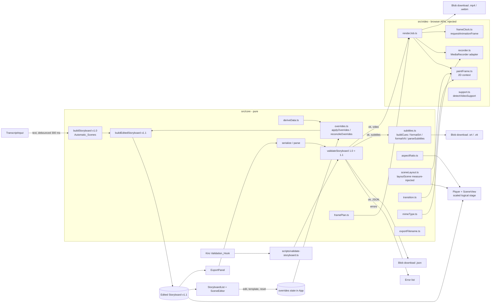
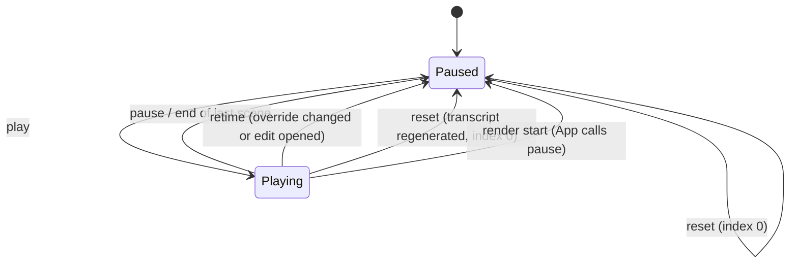
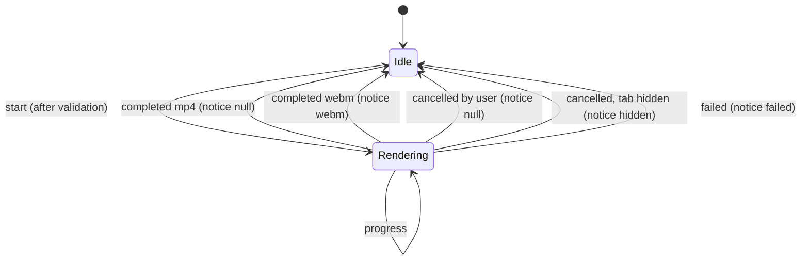

# Design Document

## Overview

This feature extends the SceneBeat MVP with three capabilities: per-scene editing (template, text, reset), subtitle export (SRT and WebVTT), and in-browser video export (canvas plus MediaRecorder) in four aspect ratios. The Player preview follows the selected aspect ratio and uses the same text layout as the video.

Design goals:

- New deterministic logic is pure TypeScript in `src/core/`: override model and merge, forced-template data derivation, subtitle cues, timestamp formatting and parsing, SRT and WebVTT formatting and parsing, the aspect-ratio table, the frame plan, the enter-transition curve, the text-fit layout (pure given a measure function), MIME-type selection, render progress, and file names. All of it is covered by fast-check properties.
- Browser-only code lives in `src/video/`: the canvas frame painter, the MediaRecorder adapter, the frame clock, feature detection, and the render job that wires them together. Every browser API is injected, so jsdom tests use a fake 2D context, a fake recorder, and a manual clock.
- React components keep only UI state. `App` owns the overrides map, aspect ratio, export format, and render status.
- The MVP storyboard pipeline (`buildStoryboard`, version `"1.0"`) is unchanged. It now produces the Automatic_Scenes. A new `buildEditedStoryboard` applies overrides and produces the version `"1.1"` storyboard that the app shows and exports. This keeps the MVP serializer path, the 1.0 round trip, and the existing tests p01 to p24 unchanged.
- No network access, backend, accounts, or audio (Requirement 17). No new runtime dependencies.

Key design decisions:

| Decision | Rationale |
|---|---|
| Overrides keyed by `(Source_Text, Occurrence_Rank)`, not by index | Requirement 6: edits survive inserting or removing other sentences. |
| `buildStoryboard` stays at version 1.0; `buildEditedStoryboard` produces 1.1 | The app creates every storyboard it shows or exports through `buildEditedStoryboard`, so Requirement 5.1 holds. Existing properties p18, p19, p21, p22 keep testing the unchanged 1.0 path. |
| One `deriveData(template, text)` used for both automatic and forced templates | Requirement 4.9: for the automatic template, it must equal `assignTemplate`. Reusing the same matchers makes this hold by construction. |
| Text layout is a pure function of `(scene, ratio, measure)`; both the DOM preview and the canvas consume its output | Requirement 8.6: preview line breaks equal video line breaks. In the browser both use the same canvas `measureText`, so widths agree. |
| Player stage is rendered at the ratio's logical pixel size (e.g. 1080x1920) and scaled with a CSS transform | Font sizes, gaps, and the enter offset are the same numbers in the DOM and the canvas. |
| Frame plan uses integer arithmetic (`k * 1000 < end * 30`) | Avoids float drift at scene boundaries in Requirement 13.8. |
| `pickMimeType(isTypeSupported)` is pure and tries H.264 MP4 first, then WebM | Requirement 14.1, testable without MediaRecorder. |
| Render job is `async` with an `AbortSignal`; cancellation resolves immediately without waiting for `onstop` | Requirement 15.5: idle within 1 second. |
| New `retime` playback action keeps the index and pauses | Requirement 7.2: an edit stops playback but keeps the position; MVP `reset` still applies to transcript regeneration. |

### Research findings

- `MediaRecorder.isTypeSupported(type)` reports whether the user agent should be able to record a given MIME type, including codecs parameters ([MDN](https://developer.mozilla.org/docs/Web/API/MediaRecorder/isTypeSupported)). The renderer probes a fixed candidate list with it.
- Chromium records MP4 from Chrome 126 onward; there are reports of playback problems with early MP4 recordings ([Chromium issue 348923066](https://issues.chromium.org/issues/348923066)) and of truncated files when an audio codec is requested with `avc1` ([Stack Overflow](https://stackoverflow.com/questions/79089296)). The renderer requests video-only `avc1` types (no `mp4a`), which also matches Requirement 14.2 (no audio track).
- Firefox records WebM only; Safari records MP4. So the WebM note in Requirement 14.6 is expected mainly in Firefox and older Chrome.
- Chrome's WebM recordings have no duration in the file header, so some players show an unknown length until the file is fully read. Fixing this needs an EBML rewriting dependency; it is accepted as a limitation and documented in the README.
- `requestAnimationFrame` is paused in hidden tabs, which would stall pacing. This is why Requirement 15.6 cancels the job when the document becomes hidden.
- jsdom implements neither a 2D canvas context nor MediaRecorder (`getContext` returns null and logs "not implemented"). Tests inject fakes and a test setup stubs `HTMLCanvasElement.prototype.getContext` to return `null`.

Content from the sources above was rephrased for compliance with licensing restrictions.

## Architecture



Data flow:

1. `App` keeps `text`. A 300 ms debounced copy feeds `buildStoryboard`, which returns the automatic storyboard (version 1.0, no `templateSource`).
2. When the automatic scenes change, `App` replaces its overrides with `reconcileOverrides(autoScenes, overrides)` (Requirement 6.4). This runs as a render-phase state adjustment, the same pattern `usePlayback` uses for `reset`.
3. `buildEditedStoryboard(auto, overrides)` returns the version 1.1 storyboard. It goes to `Player`, `StoryboardList`, and `ExportPanel`.
4. `usePlayback(durations, resetKey)` gets the edited durations. A change of `resetKey` (the automatic scenes changed) dispatches `reset`; a change of durations alone, or any override change, dispatches `retime`.
5. `ExportPanel` validates the serialized edited storyboard, then produces the chosen file. For video it starts a render job and reports progress to `App`, which locks the other controls.

### Directory changes

```
src/
  core/
    types.ts            + TemplateSource, Scene.templateSource?, SceneOverride, SceneOverrides
    deriveData.ts       deriveData, leadingLabel
    overrides.ts        overrideKey, occurrenceRanks, applyOverride(s), reconcileOverrides,
                        setManualTemplate, setEditedText, resetSceneOverride, normalizeEditedText
    editedStoryboard.ts buildEditedStoryboard, EDITED_STORYBOARD_VERSION = "1.1"
    serialize.ts        writes templateSource for version 1.1 (1.0 path unchanged)
    validate.ts         version and templateSource rules
    subtitles.ts        buildCues, formatTimestamp, parseTimestamp, formatSrt, formatVtt,
                        parseSubtitles, escapeVtt, unescapeVtt
    aspectRatio.ts      ASPECT_RATIOS, AspectRatioId, getAspectRatio
    sceneTheme.ts       colors, font family, block typography shared by DOM and canvas
    highlight.ts        highlightRanges (keyword marking, shared by DOM and canvas)
    sceneLayout.ts      layoutScene, wrapText, safeArea, FIT_SCALES
    transition.ts       ENTER_TRANSITION_MS, cubicBezier, enterTransition
    framePlan.ts        FPS, planFrames, frameCount, renderProgress, videoLengthSeconds
    mimeType.ts         MIME_CANDIDATES, pickMimeType
    exportFilename.ts   + formatTimestampTag, formatSubtitleFilename, formatVideoFilename
    renderStatus.ts     renderStatusReducer (idle / rendering / outcome notices)
  playback/
    playbackReducer.ts  + 'retime' action
    usePlayback.ts      + optional resetKey parameter
  video/
    canvasTypes.ts      FrameContext, CaptureCanvas (minimal structural types)
    measure.ts          createCanvasMeasure, fallbackMeasure
    paintFrame.ts       paintFrame
    recorder.ts         Recorder interface, createMediaRecorder
    frameClock.ts       FrameClock interface, rafClock
    support.ts          detectVideoSupport
    renderJob.ts        renderVideo
  components/
    App.tsx             new state and wiring
    AspectRatioPicker.tsx
    SceneEditor.tsx     template select, Auto/Edited chip, Edit text, Reset to automatic
    StoryboardList.tsx  rows host a SceneEditor when the `editor` prop is given
    Player.tsx          ratio-shaped screen, scaled logical stage
    SceneView.tsx       renders SceneLayout lines
    ExportPanel.tsx     format choice, sub-choice, video info, Download, progress, Cancel, notices
    download.ts         downloadBlob helper (moved out of ExportButton)
    ExportButton.tsx    removed; its tests move to ExportPanel.test.tsx
tests/
  fixtures/valid-1.1.storyboard.json, invalid-1.1.storyboard.json
  setup.ts              stubs HTMLCanvasElement.prototype.getContext -> null
```

`vite.config.ts` gains `test.setupFiles: ['tests/setup.ts']`.

## Components and Interfaces

### Core: types (`src/core/types.ts`)

```ts
export type TemplateSource = 'auto' | 'manual';

export interface Scene {
  index: number;
  text: string;
  template: SceneTemplate;
  /** Present on version "1.1" scenes; absent on version "1.0" scenes. */
  templateSource?: TemplateSource;
  durationMs: number;
  data: SceneData;
}

export interface SceneOverride {
  /** Source_Text of the Automatic_Scene the override was created on. */
  sourceText: string;
  /** Occurrence_Rank of that Automatic_Scene. */
  rank: number;
  /** Normalized, non-empty, and different from sourceText when present. */
  editedText?: string;
  manualTemplate?: SceneTemplate;
}

/** Key: overrideKey(sourceText, rank). Values never have both optional fields missing. */
export type SceneOverrides = Readonly<Record<string, SceneOverride>>;
```

### Core: data derivation (`src/core/deriveData.ts`)

```ts
/** Template data for a forced or automatic template. Precondition: text.trim() !== ''. */
export function deriveData<T extends SceneTemplate>(template: T, text: string): SceneDataByTemplate[T];

/** First whitespace token, edge punctuation removed, first 12 code points; see Glossary. */
export function leadingLabel(text: string): string;
```

`deriveData` reuses `matchQuote`, `matchTimeline`, `matchBigNumber`, and `extractKeywords` from `assignTemplate.ts` on `text.trim()`.

### Core: overrides (`src/core/overrides.ts`)

```ts
export function overrideKey(sourceText: string, rank: number): string;      // JSON.stringify([rank, sourceText])
export function occurrenceRanks(texts: readonly string[]): number[];
export function normalizeEditedText(raw: string): string;                  // CR/LF -> ' ', then trim
export const EMPTY_TEXT_MESSAGE = "Scene text can't be empty.";

/** Automatic_Scene plus optional override -> edited Scene with templateSource. */
export function applyOverride(auto: Scene, override: SceneOverride | undefined): Scene;
export function applyOverrides(autos: readonly Scene[], overrides: SceneOverrides): Scene[];

/** Keeps only overrides whose (sourceText, rank) matches some Automatic_Scene. */
export function reconcileOverrides(autos: readonly Scene[], overrides: SceneOverrides): SceneOverrides;

export function setManualTemplate(
  overrides: SceneOverrides, auto: Scene, rank: number, template: SceneTemplate,
): SceneOverrides;

export type TextEditResult =
  | { ok: true; overrides: SceneOverrides }
  | { ok: false; error: typeof EMPTY_TEXT_MESSAGE };
export function setEditedText(
  overrides: SceneOverrides, auto: Scene, rank: number, raw: string,
): TextEditResult;

export function resetSceneOverride(overrides: SceneOverrides, key: string): SceneOverrides;
export function hasOverride(overrides: SceneOverrides, auto: Scene, rank: number): boolean;
```

All functions return new objects and never mutate their inputs.

### Core: edited storyboard (`src/core/editedStoryboard.ts`)

```ts
export const EDITED_STORYBOARD_VERSION = '1.1';
/** Applies overrides to auto.scenes; keeps createdAt; version "1.1"; templateSource on every scene. */
export function buildEditedStoryboard(auto: Storyboard, overrides: SceneOverrides): Storyboard;
```

### Core: subtitles (`src/core/subtitles.ts`)

```ts
export interface SubtitleCue { number: number; startMs: number; endMs: number; text: string }

export function buildCues(sb: Storyboard): SubtitleCue[];
export type TimestampStyle = 'srt' | 'vtt';                 // ',' or '.' before milliseconds
export function formatTimestamp(ms: number, style: TimestampStyle): string;
export function parseTimestamp(s: string, style: TimestampStyle): number | null;
export function escapeVtt(text: string): string;            // & < > -> &amp; &lt; &gt;
export function unescapeVtt(text: string): string;          // &lt; &gt; first, then &amp;
export function formatSrt(cues: readonly SubtitleCue[]): string;
export function formatVtt(cues: readonly SubtitleCue[]): string;
export type SubtitleParseResult = { ok: true; cues: SubtitleCue[] } | { ok: false; error: string };
export function parseSubtitles(text: string, format: 'srt' | 'vtt'): SubtitleParseResult;
```

### Core: aspect ratio, theme, highlight, layout (`aspectRatio.ts`, `sceneTheme.ts`, `highlight.ts`, `sceneLayout.ts`)

```ts
export type AspectRatioId = '16:9' | '9:16' | '1:1' | '4:5';
export interface AspectRatioSpec {
  id: AspectRatioId; tag: '16x9' | '9x16' | '1x1' | '4x5';
  width: number; height: number; label: string; hint: string;
}
export const ASPECT_RATIOS: readonly AspectRatioSpec[];   // in the order of Requirement 8.1
export const DEFAULT_ASPECT_RATIO: AspectRatioId;         // '16:9'
export function getAspectRatio(id: AspectRatioId): AspectRatioSpec;

export interface FontSpec { sizePx: number; weight: 400 | 600 | 650 | 800 }
export type MeasureText = (text: string, font: FontSpec) => number;   // width in px

export function highlightRanges(text: string, keywords: readonly string[]): Array<[number, number]>;

export interface Rect { x: number; y: number; width: number; height: number }
export type BlockRole = 'value' | 'keywords' | 'quote' | 'label' | 'caption';
export interface LineSegment { text: string; highlight: boolean; x: number; width: number }
export interface LayoutLine {
  /** Line text as cut from the block text, trailing spaces kept; ends with '…' when truncated. */
  text: string;
  /** Width of text.trimEnd() in px. */
  width: number;
  /** Left x and baseline y in frame px, after centering. */
  x: number; baseline: number;
  segments: LineSegment[];
}
export interface LayoutBlock {
  role: BlockRole; font: FontSpec; color: string; lineHeightPx: number;
  maxWidth: number; rect: Rect; lines: LayoutLine[];
  /** Decoration area above the text (quote mark, timeline track), in px; 0 when none. */
  decorationHeight: number;
}
export interface SceneLayout {
  ratio: AspectRatioId; width: number; height: number; safe: Rect;
  /** Chosen font scale: 1.0, 0.9, ..., 0.4. */
  scale: number; truncated: boolean;
  blocks: LayoutBlock[];
  /** Bounding box of all blocks; the enter transition scales around its center. */
  stack: Rect;
}

export function safeArea(width: number, height: number): Rect;         // 6% insets
export const FIT_SCALES: readonly number[];                             // [1, .9, .8, .7, .6, .5, .4]
export function wrapText(text: string, maxWidth: number, font: FontSpec, measure: MeasureText): string[];
export function layoutScene(scene: Scene, ratio: AspectRatioId, measure: MeasureText): SceneLayout;
```

### Core: transition, frame plan, MIME, filenames, render status

```ts
// transition.ts
export const ENTER_TRANSITION_MS = 450;
export const ENTER_OFFSET_PX = 48;        // logical px, the CSS --sb-enter-offset
export function cubicBezier(x1: number, y1: number, x2: number, y2: number): (t: number) => number;
export interface EnterState { opacity: number; translateY: number; scale: number }
export function enterTransition(elapsedMs: number): EnterState;

// framePlan.ts
export const FPS = 30;
export interface PlannedFrame { k: number; timeMs: number; sceneIndex: number; elapsedMs: number }
export function frameCount(totalMs: number, fps?: number): number;   // ceil(totalMs * fps / 1000)
export function planFrames(durations: readonly number[], fps?: number): PlannedFrame[];
export function totalDuration(durations: readonly number[]): number;
export function videoLengthSeconds(totalMs: number): string;          // one decimal, e.g. "42.5"
export interface RenderProgress { percent: number; sceneNumber: number; sceneTotal: number }
export function renderProgress(renderedMs: number, totalMs: number, sceneIndex: number, sceneTotal: number): RenderProgress;

// mimeType.ts
export type VideoContainer = 'mp4' | 'webm';
export const MIME_CANDIDATES: readonly { mimeType: string; container: VideoContainer }[];
export function pickMimeType(isTypeSupported: (type: string) => boolean):
  { mimeType: string; container: VideoContainer } | null;

// exportFilename.ts (formatExportFilename keeps its current output)
export function formatTimestampTag(d: Date): string;                          // YYYYMMDD-HHmmss, local time
export function formatSubtitleFilename(d: Date, ext: 'srt' | 'vtt'): string;
export function formatVideoFilename(ratio: AspectRatioId, container: VideoContainer, d: Date): string;

// renderStatus.ts
export type RenderNotice = 'webm' | 'hidden' | 'failed' | null;
export type RenderStatus =
  | { phase: 'idle'; notice: RenderNotice }
  | { phase: 'rendering'; progress: RenderProgress };
export type RenderStatusAction =
  | { type: 'start'; sceneTotal: number }
  | { type: 'progress'; progress: RenderProgress }
  | { type: 'completed'; container: VideoContainer }
  | { type: 'cancelled'; reason: 'user' | 'hidden' }
  | { type: 'failed' };
export function renderStatusReducer(s: RenderStatus, a: RenderStatusAction): RenderStatus;
```

### Playback (`src/playback/`)

```ts
// playbackReducer.ts: new action
| { type: 'retime'; durations: readonly number[] }
// usePlayback.ts
export function usePlayback(durations: readonly number[], resetKey?: string): UsePlaybackResult;
```

`retime`: `playing = false`, `index = min(index, max(0, total - 1))`, `durations` replaced, `remainingMs = durations[index] ?? 0`, `total = durations.length`. When `resetKey` is omitted, `usePlayback` behaves as today (reset on any durations change), so `tests/usePlayback.test.ts` is unaffected. When `resetKey` is given: a changed `resetKey` dispatches `reset`; otherwise a changed durations key dispatches `retime`. App also dispatches `retime` (via a returned `retime()` helper) on every override change, because a template-only change does not change durations.

### Video (`src/video/`, browser APIs injected)

```ts
// canvasTypes.ts: the subset of CanvasRenderingContext2D the painter uses
export interface FrameContext {
  canvas: { width: number; height: number };
  fillStyle: string | CanvasGradient; globalAlpha: number; font: string;
  textBaseline: CanvasTextBaseline; textAlign: CanvasTextAlign;
  save(): void; restore(): void; translate(x: number, y: number): void; scale(x: number, y: number): void;
  setTransform(a: number, b: number, c: number, d: number, e: number, f: number): void;
  fillRect(x: number, y: number, w: number, h: number): void;
  fillText(text: string, x: number, y: number): void;
  beginPath(): void; moveTo(x: number, y: number): void; lineTo(x: number, y: number): void;
  arc(x: number, y: number, r: number, a0: number, a1: number): void;
  arcTo(x1: number, y1: number, x2: number, y2: number, r: number): void;
  closePath(): void; fill(): void;
  createLinearGradient(x0: number, y0: number, x1: number, y1: number): CanvasGradient;
  createRadialGradient(x0: number, y0: number, r0: number, x1: number, y1: number, r1: number): CanvasGradient;
  measureText(text: string): { width: number };
}

// measure.ts
export function createCanvasMeasure(ctx: Pick<FrameContext, 'font' | 'measureText'>): MeasureText; // cached
export const fallbackMeasure: MeasureText;   // deterministic estimate when no 2D context exists (jsdom)
export function createBrowserMeasure(doc: Document): MeasureText; // canvas if available, else fallback

// paintFrame.ts
export interface FrameInput { scene: Scene; layout: SceneLayout; enter: EnterState }
export function paintFrame(ctx: FrameContext, input: FrameInput): void;

// recorder.ts
export interface Recorder {
  start(): void;                       // collects chunks with a 1000 ms timeslice
  stop(): Promise<Blob[]>;             // resolves on onstop with all chunks
  discard(): void;                     // stops if needed and drops chunks; never throws
  onError(cb: (e: unknown) => void): void;
}
export type RecorderFactory = (stream: MediaStream, mimeType: string) => Recorder;
export const createMediaRecorder: RecorderFactory;   // wraps MediaRecorder, videoBitsPerSecond 8_000_000

// frameClock.ts
export interface FrameClock {
  now(): number;
  request(cb: (now: number) => void): number;
  cancel(id: number): void;
}
export const rafClock: FrameClock;    // performance.now + requestAnimationFrame

// support.ts
export interface VideoEnv {
  MediaRecorder?: { isTypeSupported?: (type: string) => boolean };
  canvasCaptureStream: boolean;       // typeof HTMLCanvasElement.prototype.captureStream === 'function'
}
export type VideoSupport =
  | { supported: true; mimeType: string; container: VideoContainer }
  | { supported: false };
export function detectVideoSupport(env: VideoEnv): VideoSupport;
export function browserVideoEnv(win: Window): VideoEnv;

// renderJob.ts
export interface RenderDeps {
  createCanvas(width: number, height: number): { ctx: FrameContext; captureStream(fps: number): MediaStream };
  createRecorder: RecorderFactory;
  clock: FrameClock;
  fontsReady(fonts: readonly FontSpec[]): Promise<void>;
  isTypeSupported(type: string): boolean;
  visibility: { isHidden(): boolean; onHidden(cb: () => void): () => void };
  measure: MeasureText;
}
export interface RenderRequest { storyboard: Storyboard; ratio: AspectRatioId }
export type RenderOutcome =
  | { kind: 'completed'; blob: Blob; container: VideoContainer }
  | { kind: 'cancelled'; reason: 'user' | 'hidden' }
  | { kind: 'failed'; error: unknown };
export function renderVideo(
  req: RenderRequest, deps: RenderDeps,
  opts: { signal: AbortSignal; onProgress(p: RenderProgress): void },
): Promise<RenderOutcome>;
```

### React components

| Component | Props | Responsibility |
|---|---|---|
| `App` | none | Owns `text`, `overrides`, `ratio`, `exportFormat`, `subtitleFormat`, `renderStatus`, and `videoSupport` (detected once). Builds the edited storyboard. Locks controls while rendering. |
| `TranscriptInput` | + `disabled` | Textarea, Load sample, Clear; all disabled while rendering (Req 15.3). |
| `AspectRatioPicker` | `value`, `onChange`, `disabled` | Radio group of four cards: ratio, platform hint, and a small shape preview (Req 8.1). Shown in step 2 above the Player. |
| `Player` | + `ratio`, `measure`, `disabled` | Ratio-shaped screen; logical stage scaled to fit; controls disabled while rendering. |
| `SceneView` | `scene`, `layout`, `reducedMotion`, `transitionMs?` | Renders layout blocks and lines; keeps the existing class names. |
| `StoryboardList` | + optional `editor: SceneEditorBindings` | Rows; each row hosts a `SceneEditor` when `editor` is given. Without it, the list is read-only as in the MVP. |
| `SceneEditor` | `scene`, `edited`, `disabled`, `onTemplateChange`, `onSaveText`, `onReset`, `onEditStart` | Template select, Auto/Edited chip, Edit text with Save and Cancel, Reset to automatic. Keeps the draft text and error locally. |
| `ExportPanel` | `storyboard`, `ratio`, `videoSupport`, `format`, `onFormatChange`, `subtitleFormat`, `onSubtitleFormatChange`, `renderStatus`, `dispatchRender`, `renderDeps?`, `validate?`, `now?` | Format choice, sub-choice, video info, Download, progress, Cancel, notices, validation errors. |

```ts
export interface SceneEditorBindings {
  isEdited(index: number): boolean;
  disabled: boolean;
  onTemplateChange(index: number, template: SceneTemplate): void;
  /** Returns null on success or the error message to show. */
  onSaveText(index: number, raw: string): string | null;
  onReset(index: number): void;
  onEditStart(index: number): void;
}
```

## Data Models

### Override record and keys

An override is stored once per `(sourceText, rank)`:

```json
{
  "[2,\"Revenue grew 45% in 2025.\"]": {
    "sourceText": "Revenue grew 45% in 2025.",
    "rank": 2,
    "editedText": "Revenue grew 46% in 2025.",
    "manualTemplate": "big-number"
  }
}
```

Invariants (maintained by every operation in `overrides.ts`):

- At least one of `editedText` and `manualTemplate` is present. An override that would have neither is deleted.
- `editedText`, when present, equals `normalizeEditedText(editedText)`, is non-empty, and differs from `sourceText`.
- The key equals `overrideKey(sourceText, rank)`.

Overrides are in-memory UI state only. They are not persisted across page reloads and are not part of the storyboard JSON (the JSON records the result through `templateSource`).

### Edited scene

`applyOverride(auto, ov)` with `effective = ov?.editedText ?? auto.text`:

| Override | `text` | `template` | `data` | `durationMs` | `templateSource` |
|---|---|---|---|---|---|
| none | `auto.text` | `auto.template` | `auto.data` | `auto.durationMs` | `auto` |
| `editedText` only | `effective` | `assignTemplate(effective).template` | `assignTemplate(effective).data` | `computeDuration(effective)` | `auto` |
| `manualTemplate` only | `auto.text` | `manualTemplate` | `deriveData(manualTemplate, auto.text)` | `auto.durationMs` | `manual` |
| both | `effective` | `manualTemplate` | `deriveData(manualTemplate, effective)` | `computeDuration(effective)` | `manual` |

`index` is always `auto.index`. Since `auto.durationMs = computeDuration(auto.text)`, the duration column is `computeDuration(effective)` in every row.

### Storyboard JSON version 1.1

```json
{
  "version": "1.1",
  "createdAt": "2026-10-31T12:00:00.000Z",
  "sceneCount": 2,
  "scenes": [
    { "index": 0, "text": "Revenue grew 45% in 2025.", "template": "big-number",
      "templateSource": "manual", "durationMs": 2750, "data": { "value": "45%" } },
    { "index": 1, "text": "Costs fell by 3 million.", "template": "big-number",
      "templateSource": "auto", "durationMs": 2250, "data": { "value": "3" } }
  ]
}
```

Rules added to the MVP rules:

- `version` must be `"1.0"` or `"1.1"`.
- Version `"1.1"`: every scene has `templateSource` equal to `"auto"` or `"manual"`, written directly after `template`.
- Version `"1.0"`: no scene has a `templateSource` key.
- Key order otherwise as in the MVP. Version 1.0 serialization is byte-identical to the MVP serializer.

### Aspect ratios

| Id | Tag | Width x height | Label | Hint |
|---|---|---|---|---|
| `16:9` | `16x9` | 1920 x 1080 | 16:9 | Landscape · YouTube |
| `9:16` | `9x16` | 1080 x 1920 | 9:16 | Portrait · TikTok, Reels, Shorts, 抖音 |
| `1:1` | `1x1` | 1080 x 1080 | 1:1 | Square |
| `4:5` | `4x5` | 1080 x 1350 | 4:5 | Portrait post · Instagram |

The short side is 1080 px for all four, so the typography table below is in absolute logical px and applies to every ratio. The Safe_Area differs per ratio:

| Ratio | Safe_Area (x, y, w, h) |
|---|---|
| 16:9 | 115.2, 64.8, 1689.6, 950.4 |
| 9:16 | 64.8, 115.2, 950.4, 1689.6 |
| 1:1 | 64.8, 64.8, 950.4, 950.4 |
| 4:5 | 64.8, 81, 950.4, 1188 |

### Scene typography (`sceneTheme.ts`, default size at scale 1.0)

| Template | Blocks, top to bottom | Font size / weight / line height | Color | Max width |
|---|---|---|---|---|
| big-number | value; caption | 200 / 800 / 1.0; 44 / 400 / 1.5 | `#ffb547`; `#a8a196` | safe width; 0.8 x safe width |
| keyword-highlight | keywords (scene text with marked keywords) | 76 / 650 / 1.35 | `#f4f0e8`, keywords `#4fd1b5` on `rgba(79,209,181,0.18)` | safe width |
| quote | quote (with a quote-mark decoration of 0.9 x font size above it); caption | 84 / 600 / 1.3; 44 / 400 / 1.5 | `#f4f0e8`, mark `#ff7a90`; `#a8a196` | safe width; 0.8 x safe width |
| timeline | label (with a track-and-dot decoration of 28 px x scale above it); caption | 140 / 800 / 1.05; 44 / 400 / 1.5 | `#6cb4ff`; `#a8a196` | safe width; 0.8 x safe width |

Block gap: 40 px x scale. Background: `#0b0a09` with the radial accent glow of `.sb-player__screen`. Font family: the `--sb-font` stack from `app.css`. Letter-spacing is `normal` in the stage, because canvas `letterSpacing` support is uneven; this is a small visual change from the MVP preview. A unit test checks that every color here equals the corresponding CSS custom property in `app.css`.

### Subtitle cue

`{ number, startMs, endMs, text }` with integer milliseconds. Example SRT and WebVTT output for two scenes of 2750 ms and 2250 ms:

```
1
00:00:00,000 --> 00:00:02,750
Revenue grew 45% in 2025.

2
00:00:02,750 --> 00:00:05,000
Costs fell by 3 million.

```

```
WEBVTT

1
00:00:00.000 --> 00:00:02.750
Revenue grew 45% in 2025.

2
00:00:02.750 --> 00:00:05.000
Costs fell by 3 million.

```

### Application state (`App`)

| State | Type | Initial | Changed by |
|---|---|---|---|
| `text` | `string` | sample transcript | TranscriptInput |
| `overrides` | `SceneOverrides` | `{}` | SceneEditor actions; reconciled when automatic scenes change |
| `ratio` | `AspectRatioId` | `'16:9'` | AspectRatioPicker |
| `exportFormat` | `'video' \| 'subtitles' \| 'storyboard-json'` | `'video'`, or `'subtitles'` when video is unsupported | ExportPanel |
| `subtitleFormat` | `'srt' \| 'vtt'` | `'srt'` | ExportPanel |
| `renderStatus` | `RenderStatus` | `{ phase: 'idle', notice: null }` | ExportPanel via `renderStatusReducer` |
| `videoSupport` | `VideoSupport` | `detectVideoSupport(browserVideoEnv(window))`, computed once | none |
| playback | `PlaybackState` | via `usePlayback` | Player, list selection, `retime`, `reset` |

Derived: `auto = buildStoryboard(debouncedText)`, `edited = buildEditedStoryboard(auto, overrides)`, `durations = edited.scenes.map(d)`, `resetKey = auto scene texts and durations joined`, `locked = renderStatus.phase === 'rendering'`, `measure = createBrowserMeasure(document)` (memoized once).

## Algorithms

### Data derivation

`deriveData(template, text)` with `t = text.trim()`:

| Template | Matcher on `t` | Fallback when the matcher returns null |
|---|---|---|
| quote | `matchQuote(t)` | `t` |
| timeline | `matchTimeline(t)` | `leadingLabel(t)` |
| big-number | `matchBigNumber(t)` | `leadingLabel(t)` |
| keyword-highlight | `extractKeywords(t)` | built in: first token, else `t` |

`leadingLabel(t)`: take the first maximal run of non-whitespace characters; strip leading and trailing characters matching `[\p{P}\p{S}]`; if the result is empty, use `t`; return the first 12 code points (`[...s].slice(0, 12).join('')`).

Every returned string is a substring of `t` and non-empty: matchers return substrings of their input, `extractKeywords` returns tokens of its input or `t`, and `leadingLabel` returns a prefix of a substring. Because `assignTemplate` calls the same matchers in rule order, `deriveData(assignTemplate(t).template, t)` equals `assignTemplate(t).data`. For whitespace at the edges, the matchers give the same result on `text` and `text.trim()`, because word boundaries at the string start and at a space behave the same.

### Occurrence ranks and reconciliation

`occurrenceRanks(texts)`: one pass with a `Map<string, number>` of counts seen so far; `rank[i] = seen(texts[i])`, then increment.

`applyOverrides(autos, overrides)`: compute ranks for `autos.map(s => s.text)`, then `autos.map((a, i) => applyOverride(a, overrides[overrideKey(a.text, ranks[i])]))`. The output has the same length and order as `autos`, so indexes stay `0..n-1` (Requirement 6.5, 6.7).

`reconcileOverrides(autos, overrides)`: build the set of live keys from the autos and their ranks, and keep exactly the overrides whose key is in that set (Requirement 6.3, 6.4). Applying it twice gives the same result, and `applyOverrides(autos, reconcileOverrides(autos, ov))` equals `applyOverrides(autos, ov)`, because unmatched overrides are never looked up.

Changing one sentence at position `j` changes only the text at `j`. Every other sentence keeps its text; its rank changes only if the old or new text at `j` equals its text and `j` comes earlier. Those are exactly the overrides Requirement 6.10 excludes, so all others are retained.

### Edit operations

- `setManualTemplate(ov, auto, rank, t)`: upsert the override for the key with `manualTemplate = t` (kept even when `t` equals the automatic template, Requirement 1.3).
- `setEditedText(ov, auto, rank, raw)`: `n = normalizeEditedText(raw)` (replace `\r\n`, `\r`, `\n` with one space, then trim). If `n === ''`, return `{ ok: false, error }` and leave `ov` unchanged (Requirement 2.7). If `n === auto.text`, remove `editedText` from the override, deleting the override if nothing remains (Requirement 2.9). Otherwise set `editedText = n`. The edited text is never re-split (Requirement 2.3).
- `resetSceneOverride(ov, key)`: return `ov` without `key`; every other entry is the same object (Requirement 3.3, 3.4).

### Serializer and validator changes

`serializeStoryboard`: `orderScene(scene, version)` inserts `templateSource` after `template` only when `version === '1.1'` and the scene has an own `templateSource` property. For any other version the output is produced by the unchanged MVP code path. The parser is unchanged; it already returns the parsed object with all keys, so `version` and `templateSource` are preserved (Requirement 5.4).

`validateStoryboard` additions, after the existing `version` type check:

1. If `version` is a string other than `"1.0"` and `"1.1"`: error at `$.version`, message `Unsupported version "<v>"; expected "1.0" or "1.1"`. Scene-level `templateSource` checks are skipped.
2. For each scene, when `version === "1.1"`: missing `templateSource` gives `$.scenes[i].templateSource` `Missing required field "templateSource"`; any value other than `"auto"` or `"manual"` gives `Scene i has invalid templateSource <value>; expected "auto" or "manual"`.
3. For each scene, when `version === "1.0"` and the scene has a `templateSource` key: error at `$.scenes[i].templateSource`, message `Field "templateSource" requires version "1.1"`.
4. When `version` is missing or not a string, no `templateSource` checks run. This keeps the existing single-error expectations in `tests/validate.test.ts` and p22.

The CLI and hook need no code change, because they call the validator. New fixtures cover version 1.1 (Requirement 5.12).

### Subtitles

- `buildCues(sb)`: running sum `start = 0`; for each scene `i`: `{ number: i + 1, startMs: start, endMs: start + d_i, text: scene.text }`, then `start += d_i`. Since `d_i >= 2000`, `endMs > startMs`.
- `formatTimestamp(ms, style)`: `h = floor(ms / 3_600_000)`, `m`, `s`, `mmm` by division and remainder; `pad(h, 2):pad(m, 2):pad(s, 2)<sep>pad(mmm, 3)` with `sep` `,` or `.`. Hours pad to at least two digits, so below 360,000,000 ms all strings have the same length, and string order equals numeric order (Requirement 11.3).
- `parseTimestamp(s, style)`: regex `^(\d{2,}):([0-5]\d):([0-5]\d)[,.](\d{3})$` with the separator fixed by style; returns null otherwise.
- `formatSrt(cues)`: for each cue `${n}\n${start} --> ${end}\n${singleLine(text)}\n\n`, concatenated; empty list gives `''`.
- `formatVtt(cues)`: `'WEBVTT\n\n'` followed by the same block shape with VTT timestamps and `escapeVtt(singleLine(text))`.
- `singleLine` replaces any CR or LF with a space. It never changes storyboard cue text, which has no line breaks, and exists so a cue can never break the block structure.
- `parseSubtitles(text, format)`: for VTT, require and strip the `WEBVTT\n\n` header. Split the rest on `\n\n`, drop the final empty piece, and for each block require exactly three lines: an integer, `<ts> --> <ts>`, and text (VTT text passed through `unescapeVtt`). `unescapeVtt` replaces `&lt;` and `&gt;` first and `&amp;` last, so `escape` then `unescape` is the identity, including text that already contains `&lt;`.
- Files are created with `new Blob([text], { type })`. Blob encodes JavaScript strings as UTF-8 and adds no byte-order mark (Requirement 12.3).

### Text layout

`layoutScene(scene, ratio, measure)`:

1. `spec = getAspectRatio(ratio)`, `safe = safeArea(spec.width, spec.height)` (6% insets).
2. Build the template's block list from the typography table. Block texts: `value`, `quote`, `label` from `scene.data`; keywords block text is `scene.text` with `highlightRanges(scene.text, keywords)`; caption is `scene.text`.
3. For each `scale` in `FIT_SCALES` (1.0 down to 0.4 in steps of 0.1, computed as `k / 10` for `k = 10..4` to avoid float accumulation): wrap each block with font size `round(default * scale)` at its max width, and compute `height = Σ(decorationHeight + lines * lineHeightPx) + gap * (blocks - 1)`. Pick the first scale whose height is at most `safe.height` (Requirement 13.11).
4. If no scale fits, use 0.4 and truncate (Requirement 13.12): walk blocks in order and lines within each block, keeping a line while the running height stays within `safe.height`. A block with no kept lines is dropped with its gap. The last kept line gets an ellipsis: remove trailing code points from it until `measure(line.trimEnd() + '…') <= maxWidth`, then append `…`.
5. Position: the stack is centered vertically in the Safe_Area; each line is centered horizontally (`x = safe.x + (safe.width - width) / 2`); baseline is `top + lineHeightPx * 0.8` within its line box, using `textBaseline = 'alphabetic'`.
6. Segments: for the keywords block, split each line at highlight range boundaries; for other blocks one segment. Segment `x` offsets are cumulative `measure(segment)` values.

`wrapText(text, maxWidth, font, measure)`, greedy:

- Tokens: each Han, Hiragana, Katakana, or full-width punctuation code point is a token; every other run of non-space characters plus the spaces that follow it is a token.
- Append tokens while `measure(current + token).trimEnd()` width is at most `maxWidth`. Otherwise start a new line with the token.
- A token wider than `maxWidth` on its own is split by code points.
- Trailing spaces stay on the line (they are measured out with `trimEnd`), so the concatenation of a block's lines equals the block text when nothing is truncated. A new line never starts with a space.

Assumption for the fit guarantee: a single code point plus `…` at 40% of the smallest default font size measures no wider than the narrowest block max width. With a 17.6 px minimum font size and a 760 px minimum max width, this holds for every real font; the property generators respect it.

Measure functions:

- Browser: `createCanvasMeasure(ctx)` sets `ctx.font = \`${weight} ${sizePx}px ${FONT_FAMILY}\`` and returns `ctx.measureText(text).width`, cached in a `Map` keyed by font and text (cleared beyond 5,000 entries). The Player and the video renderer use the same measurer, so their line breaks match.
- jsdom fallback: `fallbackMeasure` returns `sizePx` per wide code point (Han, kana, full-width) and `0.55 * sizePx` per other code point. It is deterministic, so component tests get stable lines.

### Player stage

- `.sb-player__screen` gets `data-ratio="9:16"` and the inline custom properties `--sb-ratio-w` and `--sb-ratio-h` from the ratio table. The stylesheet sets `aspect-ratio: var(--sb-ratio-w) / var(--sb-ratio-h)`, `width: min(100%, calc(var(--sb-screen-max-h) * var(--sb-ratio-w) / var(--sb-ratio-h)))`, and `--sb-screen-max-h: min(62vh, 640px)`. The screen keeps the exact proportion and fits the card (Requirement 8.5). Custom properties are used instead of an inline `aspect-ratio` because jsdom's style object drops unknown properties, so tests can read the custom properties but not `aspectRatio`.
- Inside it, `.sb-stage` is absolutely positioned with `width: Wpx; height: Hpx; transform: scale(k); transform-origin: 0 0`, where `k = screenWidth / W`. `useElementWidth` measures the screen with `ResizeObserver` (falls back to `clientWidth`, then 1, when unavailable).
- `SceneView` renders `layout.blocks` as a centered flex column with `gap` and font sizes from the layout in logical px and `white-space: nowrap`. Each block's lines are text nodes separated by `<br>`, and highlight segments are `<mark class="sb-keyword">`. The block elements keep their MVP class names (`.sb-big-number__value`, `.sb-keyword-highlight__text`, `blockquote.sb-quote__text`, `.sb-timeline__label`, `.sb-scene__caption`) so existing Player tests still find them, and a block's `textContent` equals its text when not truncated.
- The enter animation is unchanged in structure, with `translateY(var(--sb-enter-offset))` where `--sb-enter-offset: 48px` (logical px). Reduced motion keeps the 150 ms fade in the Player only.
- The template badge stays in the screen's top-left corner, outside the stage. It is Player chrome and is not drawn into the video.

### Enter transition and frame painting

- `enterTransition(e)`: `p = clamp(e / 450, 0, 1)`, `q = ease(p)` with `ease = cubicBezier(0.22, 1, 0.36, 1)` (the `--sb-ease` curve), returning `{ opacity: q, translateY: 48 * (1 - q), scale: 0.98 + 0.02 * q }`. For `e >= 450` it returns exactly `{ 1, 0, 1 }`. `cubicBezier` solves for the curve parameter by Newton iteration with a bisection fallback.
- `paintFrame(ctx, { scene, layout, enter })`: reset the transform; fill the background (base color plus the radial glow); `save`; translate to the stack center, scale by `enter.scale`, translate back, translate by `enter.translateY`, set `globalAlpha = enter.opacity`; draw decorations (quote mark glyph, timeline track gradient and dot with halo); draw every segment with `fillText` at its `x` and the line baseline, drawing highlight backgrounds as rounded rects (via `arcTo`) first; `restore`.

### Frame plan

- `T = Σ d_i`, `N = ceil(T * 30 / 1000)` computed as `Math.ceil((T * 30) / 1000)` on integers (Requirement 13.7).
- `starts` is the prefix sum. For frame `k`, the scene is the `i` with `starts[i] * 30 <= k * 1000 < (starts[i] + d_i) * 30`, found with a pointer that only moves forward (Requirement 13.8, 13.9). `timeMs = k * 1000 / 30`, `elapsedMs = timeMs - starts[i]`.
- `k < N` implies `k * 1000 < T * 30`, so every planned frame falls inside some scene.
- A scene of duration at least 34 ms spans more than one frame period (33.34 ms), so some `k` lands in it.

### Render job

`renderVideo(req, deps, { signal, onProgress })`:

1. `pick = pickMimeType(deps.isTypeSupported)`; null gives `failed`.
2. Compute `layouts` for every scene once with `deps.measure`, and `plan = planFrames(durations)`.
3. `await deps.fontsReady(fonts used by the layouts)` (Requirement 13.14). In the browser this is `document.fonts.ready` followed by `document.fonts.load()` for each `FontSpec`.
4. Create the canvas at the ratio's pixel size, paint frame 0, `stream = canvas.captureStream(30)`, create the recorder, `start()`, `t0 = clock.now()`.
5. On each clock callback: `elapsed = now - t0`; `k = min(N - 1, floor(elapsed * 30 / 1000))`; if `k` is past the last painted frame, paint `plan[k]` (frames that fell behind are skipped, which keeps the length tied to real time, Requirement 14.5); call `onProgress(renderProgress(elapsed, T, plan[k].sceneIndex, n))`; when `elapsed >= T`, call `recorder.stop()`, otherwise request the next callback.
6. Outcome: `stop()` resolves with chunks. Zero chunks or zero total size gives `failed` (Requirement 15.7). Otherwise `completed` with `new Blob(chunks, { type: 'video/mp4' | 'video/webm' })`.
7. Abort (`signal`), `visibility.onHidden`, and `recorder.onError` all go through one `finish(outcome)` that runs once: cancel the pending clock callback, call `recorder.discard()` for non-completed outcomes, stop every stream track, unsubscribe listeners, and resolve. Cancellation resolves synchronously in the abort handler, so the UI returns to idle well within 1 second (Requirement 15.5, 15.6, 15.8).

`ExportPanel` downloads the blob with `downloadBlob` (object URL created, anchor clicked, URL revoked in `finally`), using the Export_Timestamp captured when the user pressed Download.

### MIME selection

`MIME_CANDIDATES`, in order:

1. `video/mp4;codecs=avc1.640028` (mp4)
2. `video/mp4;codecs=avc1.4D401F` (mp4)
3. `video/mp4;codecs=avc1.42E01E` (mp4)
4. `video/mp4;codecs=avc1` (mp4)
5. `video/webm;codecs=vp9` (webm)
6. `video/webm;codecs=vp8` (webm)
7. `video/webm` (webm)

`pickMimeType` returns the first candidate for which `isTypeSupported` returns true. A predicate that throws counts as false. Plain `video/mp4` is not a candidate, because Chrome may record VP9 inside MP4 for it, which is not H.264 (Requirement 14.1).

`detectVideoSupport(env)` returns `supported: true` only when `env.MediaRecorder` exists, `env.canvasCaptureStream` is true, and `pickMimeType` finds a candidate (Requirement 16.1).

## State and Interaction

### Playback during edits and rendering



- Opening the text editor, changing a template, saving text, and resetting a scene all call `pause()` and then `retime()`. This covers Requirement 7.2 and the "editing pauses playback" goal.
- Changing the aspect ratio changes neither the storyboard nor playback (Requirement 8.7); only the layout is recomputed.

### Render status



While `phase === 'rendering'`, `locked` is true and disables: TranscriptInput, Load sample, Clear, every SceneEditor control, AspectRatioPicker, the format choice and sub-choice, Download, and Play/Pause/Previous/Next (Requirement 15.3). Cancel is the only enabled export control. Selecting a list row stays enabled; it does not affect the job, because the job works on a snapshot of the storyboard and ratio taken at start (Requirement 13.3).

## UI

The UI targets beginners: plain words, one decision at a time, no codec or file-format jargon beyond the labels the requirements fix.

### Step 2: shape and preview

- Above the Player, a "Video shape" radio group of four cards. Each card shows a small outlined rectangle in the ratio's proportion, the ratio (`16:9`), and the hint (`Landscape · YouTube`). Arrow keys move between cards (native radio inputs).
- The Player screen takes the chosen shape. For 9:16 it is tall and narrow, centered in the card.

### Scene list rows with SceneEditor

Each row (one `<li>`) has two lines:

```
[3]  Revenue grew 45% in 2025.                                   (Edited)
     Template: [Big number ▾]   [Edit text]   [Reset to automatic]
```

- The number and text are one button that selects the scene, as in the MVP. Its accessible name starts with `Scene 3:`.
- Template select: a native `<select>` labeled "Template for scene 3", options with the existing plain names: Big number, Keywords, Quote, Timeline (Requirement 1.1).
- Status chip: "Edited" when the scene has an override, otherwise "Auto" (Requirement 1.2). An override with only a text edit also shows "Edited".
- Edit text: replaces the text line with a textarea (auto-sized, Enter saves, Shift+Enter is ignored since line breaks become spaces, Escape cancels), plus Save and Cancel buttons. An empty save keeps the editor open and shows "Scene text can't be empty." under the field with `role="alert"` (Requirement 2.7). The buttons have accessible names that include the scene number (for example "Edit text of scene 3"), so names are unique.
- Reset to automatic: enabled only when the scene has an override (Requirement 3.1, 3.2).
- Only one editor is open at a time. Opening one closes another without saving.
- The summary counts above the list are computed from the edited storyboard, so they update with every change (Requirement 1.5).

### Step 3: export panel

- Title: "Download".
- A radio group of three large options with label and one-line description: Video, Subtitles, Storyboard (JSON) (Requirement 9.1). When Subtitles is chosen, a nested radio pair appears: "SRT (works almost everywhere)" (default) and "WebVTT (web players and YouTube)" (Requirement 9.2).
- When Video is chosen, an info line: `16:9 · 42.5 seconds` (Requirement 9.4).
- One primary Download button whose visible name follows the format: "Download video", "Download subtitles", "Download storyboard". It is disabled when there are no scenes (Requirement 9.6).
- While rendering: a progress bar (`<progress max="100">`), `37%`, `Scene 4 / 12`, the "Keep this tab open…" message, and a Cancel button (Requirement 15.1, 15.2, 15.4).
- Notices after a job: the WebM note, the hidden-tab message, or the failure message, as an inline status (`role="status"`, failure uses `role="alert"`). A notice clears when the next export starts.
- When video is unsupported: the Video option is disabled, Subtitles is preselected, and the unsupported message is shown under the options (Requirement 16.2).
- Validation errors use the MVP error panel markup (`role="alert"`, `path: message` list) for every format (Requirement 9.8).

## Correctness Properties

*A property is a characteristic or behavior that should hold true across all valid executions of a system-essentially, a formal statement about what the system should do. Properties serve as the bridge between human-readable specifications and machine-verifiable correctness guarantees.*

Numbering continues from the MVP (P01 to P24). Each property is one fast-check test in `tests/properties/pNN-<name>.property.test.ts`.

Reflection: the per-template derivation rules (4.1 to 4.7) and determinism (4.10) form one model property. The merge rules for templates, text, duration, keys, and order (1.4, 2.3 to 2.6, 6.2, 6.3, 6.5, 6.7, 6.8) form one model property whose reference model also checks length and order. Text normalization, empty rejection, and equal-to-source removal (2.2, 2.7, 2.9) share one edit-operation property with the manual-template rule (1.3). Version 1.1 creation, key order, and acceptance (5.1, 5.2, 5.6, 5.11) form one property; the round trip covers 5.3, 5.4, and 5.10. Cue rules 10.1 to 10.6 form one property. Escaping and single-line output (11.6, 11.7) are checked inside the subtitle round trip. Both filename patterns (12.4, 14.4) share one property. Frame timing rules 13.6 to 13.8 form one model property. The layout rules form two properties: 13.10 with 13.13, and 13.11 with 13.12. UI, browser API, and repository criteria are example, integration, or smoke tests in the Testing Strategy. Requirement 3.5 is implied by Property 29 with an empty map but is kept as its own small property because the requirement names it.

### Property 25: Data derivation follows matcher-or-fallback rules

For any Scene_Template and any text that is non-empty after trimming, `deriveData(template, text)` equals the template's matcher result on `text.trim()` when that result is non-null (`matchQuote` for quote, `matchTimeline` for timeline, `matchBigNumber` for big-number, `extractKeywords` for keyword-highlight), and otherwise the fallback (the trimmed text for quote, `leadingLabel(text.trim())` for timeline and big-number); and calling it twice returns deeply equal data.

**Validates: Requirements 4.1, 4.2, 4.3, 4.4, 4.5, 4.6, 4.7, 4.10**

### Property 26: Data derivation is total

For any Scene_Template and any text that is non-empty after trimming, `deriveData(template, text)` returns an object with exactly the data key required for that template, every value (or every keyword, of which there are 1 to 3) is a non-empty string, and every value is a substring of `text.trim()`.

**Validates: Requirements 4.8**

### Property 27: Data derivation agrees with automatic assignment

For any text that is non-empty after trimming, with `a = assignTemplate(text.trim())`, `deriveData(a.template, text)` deeply equals `a.data`.

**Validates: Requirements 4.9**

### Property 28: Empty overrides are the identity

For any transcript, `applyOverrides(auto.scenes, {})` returns scenes deeply equal to `auto.scenes` with `templateSource: "auto"` added to each.

**Validates: Requirements 3.5**

### Property 29: Override merge matches the reference model

For any transcript and any set of Scene_Overrides (generated with keys taken both from the transcript's `(text, rank)` pairs and from unrelated pairs, with edited texts that may contain Sentence_Terminators, and manual templates that may equal the automatic template), `applyOverrides(autos, overrides)` has the same length as `autos`, has `index` values `0..n-1` in order, and each scene equals a reference model: the Automatic_Scene when no override has its `(text, rank)`, and otherwise the scene with `text = editedText ?? source`, `template = manualTemplate ?? assignTemplate(text).template`, `data = manualTemplate ? deriveData(manualTemplate, text) : assignTemplate(text).data`, `durationMs = computeDuration(text)`, and `templateSource = manualTemplate ? "manual" : "auto"`.

**Validates: Requirements 1.4, 2.3, 2.4, 2.5, 2.6, 6.2, 6.3, 6.5, 6.7, 6.8**

### Property 30: Reconciliation discards unmatched overrides and is idempotent

For any list of Automatic_Scenes and any set of Scene_Overrides, `r = reconcileOverrides(autos, overrides)` contains exactly the overrides whose `(sourceText, rank)` matches an Automatic_Scene; `reconcileOverrides(autos, r)` equals `r`; and `applyOverrides(autos, r)` deeply equals `applyOverrides(autos, overrides)`.

**Validates: Requirements 6.4, 6.9**

### Property 31: Overrides survive a one-sentence change

For any list of sentences, any position `j`, any replacement sentence, and any set of overrides on the original Automatic_Scenes, after replacing sentence `j` and reconciling, every override whose scene is not at `j` and whose Occurrence_Rank is the same in the new list is retained with all fields unchanged.

**Validates: Requirements 6.10**

### Property 32: Edit operations record edits as specified

For any Automatic_Scene, rank, override set, Scene_Template `t`, and raw string `r`: `setManualTemplate` yields an override for the scene with `manualTemplate = t` (also when `t` equals the automatic template); `setEditedText` with `r` returns `{ ok: false, error: "Scene text can't be empty." }` and leaves the set unchanged when `normalizeEditedText(r)` is empty, removes `editedText` when the normalized text equals the Source_Text, and otherwise records `editedText = normalizeEditedText(r)`, which contains no CR or LF and equals its own trimmed form.

**Validates: Requirements 1.3, 2.2, 2.7, 2.9**

### Property 33: Reset restores the automatic scene and nothing else

For any transcript, any set of overrides, and any scene `i`, after `resetSceneOverride` on scene `i`'s key, scene `i` of `applyOverrides` deeply equals the Automatic_Scene with `templateSource: "auto"`, and every other key in the set maps to the same override as before.

**Validates: Requirements 3.3, 3.4**

### Property 34: Edited storyboards are valid version 1.1 storyboards

For any transcript and any set of overrides, `buildEditedStoryboard(buildStoryboard(text), overrides)` has `version` `"1.1"`; its serialization has scene keys in the order `index`, `text`, `template`, `templateSource`, `durationMs`, `data` with `templateSource` in `{"auto", "manual"}`; and `validateStoryboard` on the parsed serialization returns an empty list.

**Validates: Requirements 5.1, 5.2, 5.6, 5.11**

### Property 35: Round trip for versions 1.0 and 1.1

For any transcript and any set of overrides, for both the version 1.0 storyboard (`buildStoryboard`) and the version 1.1 storyboard (`buildEditedStoryboard`), serializing, parsing, and serializing again produces identical text; the parsed value keeps `version` and, for 1.1, every scene's `templateSource`; and the 1.0 serialization contains no `templateSource` key.

**Validates: Requirements 5.3, 5.4, 5.10**

### Property 36: Version and templateSource errors are reported at their paths

For any valid storyboard value of version 1.0 or 1.1 and any single mutation drawn from {set `version` to a string other than "1.0" and "1.1", remove a scene's `templateSource` from a 1.1 value, set it to a value other than "auto" or "manual", add a `templateSource` to a scene of a 1.0 value}, `validateStoryboard` returns at least one error, and an error exists at `$.version` naming the unsupported value, or at `$.scenes[i].templateSource` for the mutated scene `i`, as applicable.

**Validates: Requirements 5.7, 5.8, 5.9**

### Property 37: Retiming pauses and keeps the position

For any playback state reached by any action sequence and any new durations list of the same length, `retime` yields `playing = false`, the same `index`, `durations` equal to the new list, and `remainingMs` equal to the new duration at `index`.

**Validates: Requirements 7.2, 7.3**

### Property 38: Aspect ratio dimensions

For any Aspect_Ratio in the table, `width * second = height * first` for the ratio `first:second`, both dimensions are even positive integers, and the dimensions equal those listed in Requirement 8.3.

**Validates: Requirements 8.3, 8.4**

### Property 39: Video length label

For any list of Display_Durations, `videoLengthSeconds(totalDuration(durations))` equals `(Math.round(sum / 100) / 10).toFixed(1)`, which is the sum divided by 1000 rounded to one decimal place.

**Validates: Requirements 9.4**

### Property 40: Subtitle cues follow scene timing

For any edited storyboard, `buildCues` returns one cue per scene in order with numbers `1..n`; cue 1 starts at 0; each cue starts where the previous one ends; each cue's end minus start equals its scene's Display_Duration and is positive; the last cue ends at the sum of all durations; and each cue's text equals its scene's text.

**Validates: Requirements 10.1, 10.2, 10.3, 10.4, 10.5, 10.6**

### Property 41: Timestamp round trip

For any integer `ms` from 0 to 359,999,999 and either style, `formatTimestamp(ms, style)` matches `^\d{2}:\d{2}:\d{2},\d{3}$` (SRT) or `^\d{2}:\d{2}:\d{2}\.\d{3}$` (VTT), and `parseTimestamp` of it returns `ms`.

**Validates: Requirements 11.1, 11.2**

### Property 42: Timestamps sort like their values

For any integers `0 <= a < b < 360,000,000` and either style, `formatTimestamp(a, style) < formatTimestamp(b, style)` in plain string comparison.

**Validates: Requirements 11.3**

### Property 43: SRT and WebVTT round trip

For any edited storyboard (with generated scene texts that include `&`, `<`, `>`, `-->`, existing entities such as `&lt;`, CJK, and emoji), with `cues = buildCues(sb)`: `parseSubtitles(formatSrt(cues), 'srt')` and `parseSubtitles(formatVtt(cues), 'vtt')` both return `{ ok: true, cues }`; neither output contains `\r`; every cue block has exactly three lines; and the VTT cue text lines contain no `<` or `>`.

**Validates: Requirements 11.6, 11.7, 11.9, 11.10**

### Property 44: Subtitle and video file names

For any valid `Date`, Aspect_Ratio, and Video_Container, `formatSubtitleFilename(d, ext)` matches `^scenebeat-subtitles-\d{8}-\d{6}\.(srt|vtt)$` with the given extension, `formatVideoFilename(r, c, d)` matches `^scenebeat-video-(16x9|9x16|1x1|4x5)-\d{8}-\d{6}\.(mp4|webm)$` with the Ratio_Tag of `r` and the extension `c`, and in both the digits equal the date's local year, month, day, hour, minute, and second, zero-padded.

**Validates: Requirements 12.4, 14.4**

### Property 45: Frame plan matches cue intervals

For any list of Display_Durations, `planFrames` returns `ceil(T * 30 / 1000)` frames; frame `k` has `timeMs = k * 1000 / 30`; its `sceneIndex` is the scene whose interval `[start, end)` from `buildCues` contains `timeMs`; and its `elapsedMs` equals `timeMs - start`.

**Validates: Requirements 13.6, 13.7, 13.8**

### Property 46: Frame plan is ordered and covers every scene

For any list of Display_Durations (including durations below 2000 ms down to 1 ms, to exercise the bound), the `sceneIndex` values of consecutive frames are non-decreasing, and every scene with a duration of at least 34 ms is named by at least one frame.

**Validates: Requirements 13.9**

### Property 47: Enter transition plays at each scene start and ends inside the scene

For any list of Display_Durations within [2000, 8000], for the planned frames, `enterTransition(frame.elapsedMs)` has opacity, translate, and scale within their start and end values; the first frame of every scene, including scene 0, has opacity below 1 (the transition is applied regardless of any reduced-motion setting, which the renderer does not read); and every frame with `elapsedMs >= 450` has exactly opacity 1, translate 0, and scale 1, so each transition finishes before its scene ends.

**Validates: Requirements 13.4, 13.5**

### Property 48: Layout stays inside the Safe_Area and keeps the text

For any scene (generated from transcripts and overrides, including very long English and CJK texts and unbroken tokens), any Aspect_Ratio, and any measure function from a generated family (per-code-point widths between 0.3 and 1.2 times the font size), every line of `layoutScene` has width at most its block's max width and at most the Safe_Area width, every line box lies within the Safe_Area, the total stacked height is at most the Safe_Area height, and when `truncated` is false each block's lines concatenate to exactly the block's text.

**Validates: Requirements 13.10, 13.13**

### Property 49: Layout picks the largest fitting scale, else truncates at 40%

For any scene, Aspect_Ratio, and measure function as in Property 48, if some scale in 1.0, 0.9, ..., 0.4 fits, `layoutScene` uses the largest such scale and `truncated` is false, and no larger scale fits; if none fits, it uses scale 0.4, `truncated` is true, and the last kept line ends with `…`.

**Validates: Requirements 13.11, 13.12**

### Property 50: Container selection prefers H.264 MP4, then WebM

For any predicate over the MIME candidates (including predicates that throw), `pickMimeType` returns the first MP4 `avc1` candidate the predicate accepts when one exists, otherwise the first accepted WebM candidate, otherwise null; the returned container matches the MIME type's prefix; and `detectVideoSupport` reports supported exactly when MediaRecorder is present, `captureStream` is present, and `pickMimeType` returns a candidate.

**Validates: Requirements 14.1, 16.1**

### Property 51: Render progress

For any total length `T > 0`, rendered time `t` in `[0, T]`, and scene index `i` in `[0, n)`, `renderProgress(t, T, i, n)` has `percent = floor(100 * t / T)` within 0 to 100, `sceneNumber = i + 1`, and `sceneTotal = n`; and for `t1 <= t2`, the percent for `t1` is at most the percent for `t2`.

**Validates: Requirements 15.1**

## Error Handling

| Situation | Handling |
|---|---|
| Saved text empty after trimming | `setEditedText` returns the error; the editor stays open with "Scene text can't be empty."; overrides unchanged. |
| Override refers to a sentence that no longer exists | Dropped by `reconcileOverrides` on regeneration; no message (Requirement 6.4). |
| Forced template finds nothing to highlight | `deriveData` falls back to the trimmed text or the Leading_Label; never empty. |
| Validation fails at export (any format) | No file and no render job; error list with JSON paths (Requirement 9.8). |
| Storyboard JSON with unknown `version` or bad `templateSource` (CLI, hook) | Path-based errors; CLI exits 1. |
| Subtitle text that is not SRT/WebVTT produced by SceneBeat | `parseSubtitles` returns `{ ok: false, error }` naming the block number; it never throws. Only used by tests and tooling. |
| No 2D canvas context (jsdom, locked-down browser) | `createBrowserMeasure` falls back to `fallbackMeasure`; video is reported unsupported if `captureStream` or MediaRecorder is missing. |
| Video export unsupported | Video option disabled, Subtitles preselected, message shown (Requirement 16.2). |
| `isTypeSupported` throws | Treated as false for that candidate. |
| Fonts never finish loading | `fontsReady` races a 3-second timeout, then rendering proceeds with whatever fonts are available; Player and video still share the same measurer. |
| MediaRecorder `error` event or `start()` throws | `failed` outcome; no file; failure message; controls re-enabled (Requirement 15.7). |
| Recording produced zero bytes | `failed` outcome, same handling. |
| User cancels | Resolve `cancelled` immediately, discard chunks, stop tracks; idle within 1 second (Requirement 15.5). |
| Tab hidden during render | `cancelled` with reason `hidden`; hidden-tab message (Requirement 15.6). |
| Component unmounts during render | `ExportPanel` aborts the job in effect cleanup. |
| Object URL for a download | Created and revoked in `try/finally` around the anchor click (Requirement 15.8). |
| Very long transcript and video | Frame plan is linear in frame count (for example 24,000 frames for 800 s); layouts are computed once per scene before recording; the measure cache is bounded. |
| WebM file without duration metadata (Chrome) | Accepted limitation; README explains it and suggests converting to MP4 when an editor shows no length. |

## Testing Strategy

Property-based testing applies to the new pure core: data derivation, override merging, serialization and validation, subtitle formatting and parsing, frame planning, layout math, MIME selection, and progress. The UI, the canvas painter, the recorder adapter, and repository changes are covered by example, integration, and smoke tests with injected fakes. Visual quality and real recording are checked manually.

**Libraries**: Vitest (jsdom), fast-check, React Testing Library. No property-testing framework is written from scratch.

### Property tests (`tests/properties/p25-*.property.test.ts` to `p51-*.property.test.ts`)

- One fast-check test per property above, `{ numRuns: 100 }` or more, each in its own file.
- Each file starts with `// Feature: scenebeat-edit-export, Property N: <property text>` and carries `**Validates: Requirements X.Y**` in the test's doc comment, as in p01 to p24.
- Planned files: `p25-derive-data-model`, `p26-derive-data-total`, `p27-derive-data-agrees`, `p28-overrides-identity`, `p29-overrides-merge-model`, `p30-overrides-reconcile`, `p31-overrides-metamorphic`, `p32-edit-operations`, `p33-reset-scene`, `p34-edited-storyboard-valid`, `p35-roundtrip-versions`, `p36-validator-version`, `p37-playback-retime`, `p38-aspect-ratio`, `p39-video-length`, `p40-subtitle-cues`, `p41-timestamp-roundtrip`, `p42-timestamp-order`, `p43-subtitle-roundtrip`, `p44-export-filenames`, `p45-frame-plan-model`, `p46-frame-plan-coverage`, `p47-enter-transition`, `p48-layout-fits`, `p49-layout-scale`, `p50-mime-selection`, `p51-render-progress`.
- Shared arbitraries in `tests/properties/arbitraries.ts` (new): the transcript arbitrary used by p19/p21 (copied, not imported from those files); an override-set arbitrary built from a transcript's `(text, rank)` pairs plus unrelated keys; edited text with terminators, line breaks, CJK, emoji, `&<>`; Display_Duration lists; a measure-function family `(cp, font) => factor(cp) * font.sizePx` with per-code-point factors in [0.3, 1.2].
- The reference models in p29 and p45 are written independently in the test (straight-line code from the requirement text), not by calling the code under test.

### Unit and component tests (`tests/*.test.ts(x)`)

- `deriveData.test.ts`: one example per row of the derivation table, `leadingLabel` with punctuation-only tokens and long tokens.
- `overrides.test.ts`: duplicate sentences get ranks 0, 1, 2; an edit on the second duplicate stays on it after a sentence is inserted before the first.
- `subtitles.test.ts`: the exact SRT and WebVTT texts shown in Data Models; empty list outputs (Requirement 11.8); escaping examples; UTF-8 without BOM by reading the Blob bytes (`EF BB BF` absent, `TextDecoder` round trip) (Requirement 12.3).
- `validate.test.ts` additions: one example per new message form; existing cases unchanged.
- `sceneLayout.test.ts`: a short sentence at 16:9 uses scale 1.0; a 600-character CJK text at 9:16 is truncated with `…`; theme colors equal the CSS custom properties in `app.css`.
- `paintFrame.test.ts`: a recording fake `FrameContext` (an object that logs calls and property sets). For each template: background fill first, `fillText` called with each layout line's segments at layout coordinates, highlight color for keywords, accent colors per template; `globalAlpha` equals the enter state's opacity (Requirement 13.2, 13.4).
- `renderJob.test.ts` with a manual `FrameClock`, a fake recorder (records `start`/`stop`/`discard`, emits chunks on demand), a fake canvas factory, a controllable `fontsReady` promise, and a fake visibility source:
  - canvas created at ratio dimensions, `captureStream(30)`, and the stream has no audio track (Requirement 13.1, 14.2, 17.3);
  - nothing painted before `fontsReady` resolves (Requirement 13.14);
  - advancing the clock paints frames by elapsed time, skips frames when behind, and calls `stop()` once elapsed reaches `T` (Requirement 14.5);
  - progress callbacks match `renderProgress` (Requirement 15.1);
  - abort resolves `cancelled` synchronously, calls `discard`, stops tracks, and cancels the pending clock callback (Requirement 15.5, 15.8);
  - hidden visibility resolves `cancelled` with reason `hidden` (Requirement 15.6);
  - recorder error and empty chunks resolve `failed` (Requirement 15.7);
  - editing the storyboard object after start does not change painted text (Requirement 13.3).
- `playbackReducer` examples for `retime`; `usePlayback.test.ts` gains cases for `resetKey` (reset vs. retime). Existing cases stay as they are.
- `StoryboardList.test.tsx` (existing cases unchanged, since the read-only list renders as before) plus `SceneEditor.test.tsx`: four template options, selected value, Auto/Edited chip, Edit/Save/Cancel, empty-text message, Reset enabled state (Requirements 1.1, 1.2, 2.1, 2.7, 2.8, 3.1, 3.2).
- `AspectRatioPicker.test.tsx`: four options with labels and hints, `16:9` checked initially (Requirement 8.1, 8.2).
- `Player.test.tsx` additions: the screen's `data-ratio` and `--sb-ratio-w` / `--sb-ratio-h` equal the table values for each ratio, and `app.css` defines `aspect-ratio` from those properties; `SceneView` line text equals `layoutScene` lines with `fallbackMeasure` (Requirement 8.5, 8.6). Existing cases keep passing because block class names and `textContent` are unchanged.
- `ExportPanel.test.tsx` replaces `ExportButton.test.tsx` and keeps all of its cases against the "Storyboard (JSON)" option with the "Download storyboard" button. New cases: labels and descriptions, SRT default, Video default when supported and Subtitles when not, the info line, disabled Download with zero scenes, validation before any file for each format (stubbed validator), `.srt`/`.vtt` names and MIME types, video download name and MIME with an injected fake `renderDeps`, WebM note, progress UI, Cancel, failure and hidden messages, and `fetch`/`XMLHttpRequest` spies never called (Requirements 9, 12.1, 12.2, 14.3, 14.6, 15, 16, 17.1).
- `App.test.tsx` additions: a template change updates counts and the Player and pauses playback while keeping the position; a text edit leaves the textarea content unchanged; edits survive a typing change elsewhere in the transcript and are dropped by Clear; ratio change keeps playback position; while a fake render job runs, the listed controls are disabled (Requirements 1.5, 2.10, 6.1, 6.6, 7.1 to 7.4, 8.7, 15.3).
- Test setup (`tests/setup.ts`): `HTMLCanvasElement.prototype.getContext` returns `null`, so the app falls back to `fallbackMeasure` and reports video as unsupported unless a test installs fakes for `MediaRecorder` and `captureStream`.

### Integration and smoke tests

- `validateCli.test.ts`: new fixtures `valid-1.1.storyboard.json` (exit 0) and `invalid-1.1.storyboard.json` (exit 1, output contains `$.scenes[1].templateSource`) (Requirement 5.12). The existing 1.0 fixtures keep their results.
- `repo.test.ts`: `product.md` scope section mentions in-browser video and SRT/WebVTT and still excludes audio, backend, and native editor formats; `README.md` has the same scope note and the WebM limitation; no `fetch(`, `XMLHttpRequest`, `WebSocket`, or `EventSource` in `src/` (Requirements 17.2, 17.5).
- `pnpm build` passes with `tsc --noEmit` (run manually or in CI).

### Manual checks in Chrome (and spot checks in Firefox and Safari)

- Preview and exported video look the same for each template and each ratio, including line breaks (Requirement 8.6, 13.2).
- The Player stage keeps the ratio within 1% at several window sizes (Requirement 8.5).
- Recorded file plays in the system player, VLC, and imports into CapCut/剪映 or Premiere; length equals the sum of durations within 250 ms (Requirement 14.5); Chrome 126+ and Safari produce MP4, Firefox produces WebM with the note.
- SRT and WebVTT files import into CapCut/剪映, Premiere Pro, DaVinci Resolve, and YouTube with cue times aligned to the video.
- Switching tabs during a render cancels it with the hidden-tab message.

## Repository and Documentation Changes

- `.kiro/steering/product.md`: update `## Scope boundaries (MVP)` to say that in-browser video rendering (canvas plus MediaRecorder, silent) and SRT/WebVTT subtitles are in scope per `.kiro/specs/scenebeat-edit-export/`; audio, backend, accounts, network requests, and native editor project formats remain out of scope. Update the Storyboard JSON paragraph for version `"1.1"` and `templateSource`.
- `.kiro/steering/structure.md`: add `src/video/`, the new core modules, and the new components.
- `README.md`: feature summary for editing, subtitles, and video; supported browsers; WebM note and duration-metadata limitation; scope note matching `product.md`.
- `.kiro/hooks/validate-storyboard.json`: unchanged; the CLI it runs accepts both versions through the validator.
