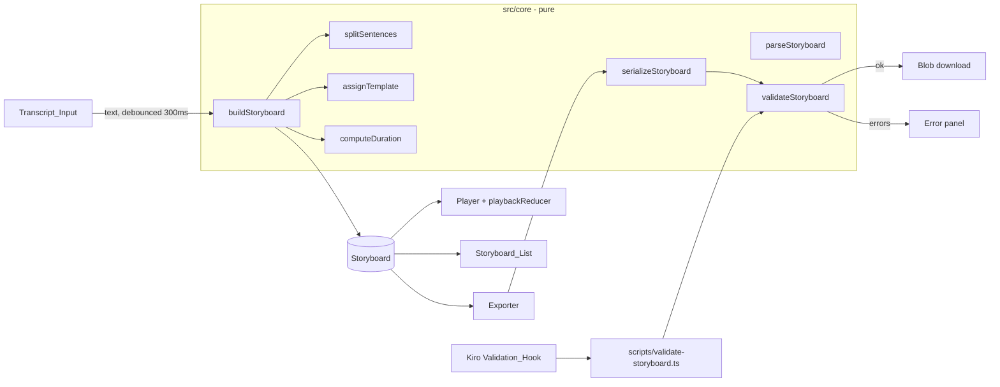
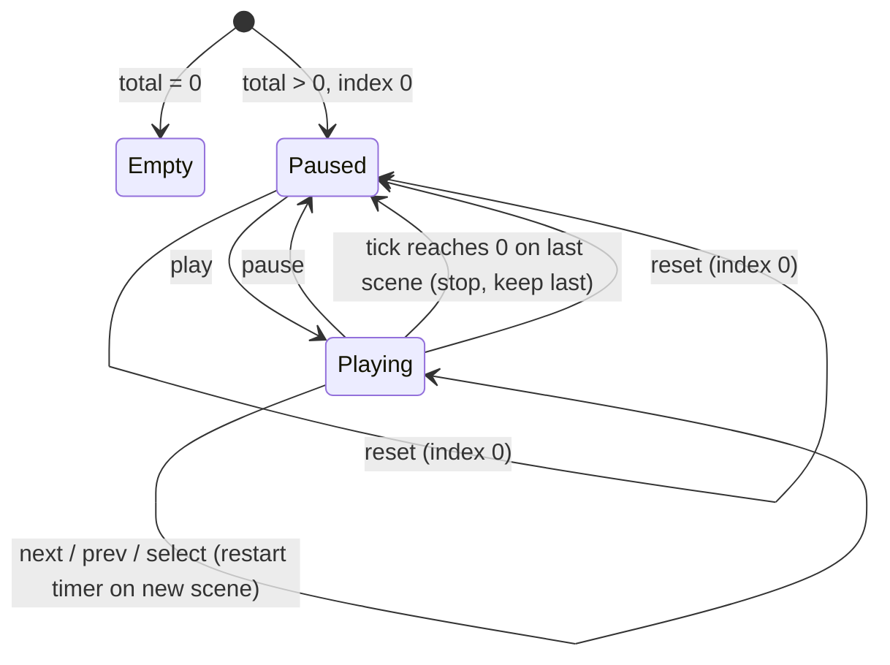

# Design Document

## Overview

SceneBeat is a static, client-side web app. The user pastes a transcript. The app splits it into sentences, assigns each sentence one of four motion templates (`big-number`, `keyword-highlight`, `quote`, `timeline`), computes a reading-pace duration per scene, previews the sequence with animated transitions, lists all scenes, and exports a validated storyboard JSON file.

Design goals:

- Transcript logic lives in pure, framework-free TypeScript functions under `src/core/`. They are deterministic and free of I/O, so they can be tested directly with property-based tests.
- React components hold only UI state and call the pure core.
- Playback logic is a pure reducer plus a thin timer hook, so timing behavior is testable without a browser.
- No network access, backend, accounts, audio, or video rendering (Requirement 10).

Stack: Vite, React 18, TypeScript (`strict: true`), Vitest, fast-check, React Testing Library with jsdom. Transitions are CSS transitions, so no animation library is needed.

Key design decisions:

| Decision | Rationale |
|---|---|
| Pure core, thin UI | Requirements 2, 3, 4, 7, 8 are pure data transformations with strong invariants. |
| Hand-written scanner for sentence splitting | The digit-period rule, terminator runs, and closer attachment are easier to get right as a small scan than as one large regex. |
| Rule chain with fixed precedence (quote, timeline, big-number, keyword) | Matches Requirements 3.2 to 3.5 and makes determinism trivial. |
| Validator takes `unknown` and returns a list of errors | It must accept arbitrary JSON and be reused by the export flow and the Kiro hook. |
| Playback as a reducer that tracks remaining time | Pause and resume must continue the remaining duration (Requirement 5.4). |
| Validator also exposed as a Node CLI script | The Kiro hook (Requirement 11.4) runs outside the browser. |

## Architecture



Data flow: `App` owns the `text` state. A copy debounced by 300 ms feeds `buildStoryboard`, which returns a `Storyboard`. The storyboard goes to `Player`, `StoryboardList`, and `ExportButton`. The playback state (current index, playing flag) lives in `App` through `usePlayback` and is shared by `Player` and `StoryboardList`.

### Directory structure

```
.kiro/
  hooks/validate-storyboard.json
  steering/{product.md, tech.md, structure.md}
  specs/scenebeat-mvp/...
scripts/validate-storyboard.ts      # CLI wrapper around validateStoryboard
src/
  core/
    types.ts            # Scene, Storyboard, SceneData, TEMPLATES
    splitSentences.ts
    assignTemplate.ts
    duration.ts
    buildStoryboard.ts
    serialize.ts        # serializeStoryboard, parseStoryboard
    validate.ts
    exportFilename.ts
  playback/
    playbackReducer.ts
    usePlayback.ts      # timer hook
  components/
    App.tsx, TranscriptInput.tsx, Player.tsx, SceneView.tsx,
    StoryboardList.tsx, ExportButton.tsx
  data/sampleTranscript.ts
  styles/app.css
  main.tsx
tests/                  # *.test.ts(x), *.property.test.ts
LICENSE, README.md, .gitignore, index.html, vite.config.ts, tsconfig.json
```

## Components and Interfaces

### Core modules (pure)

```ts
type SceneTemplate = 'big-number' | 'keyword-highlight' | 'quote' | 'timeline';
const TEMPLATES: readonly SceneTemplate[];

splitSentences(text: string): string[]
assignTemplate(sentence: string): { template: SceneTemplate; data: SceneData }
readingLength(sentence: string): { englishWords: number; chineseChars: number }
computeDuration(sentence: string): number          // ms, clamped to [2000, 8000]
buildStoryboard(text: string, now?: Date): Storyboard
serializeStoryboard(sb: Storyboard): string        // 2-space indent
parseStoryboard(json: string): { ok: true; value: Storyboard } | { ok: false; error: string }
validateStoryboard(value: unknown): ValidationError[]   // empty array means valid
formatExportFilename(d: Date): string              // scenebeat-storyboard-YYYYMMDD-HHmmss.json
```

### React components

| Component | Props | Responsibility |
|---|---|---|
| `App` | none | Owns `text`, debounced storyboard, playback state. Lays out the panels. |
| `TranscriptInput` | `value`, `onChange`, `onLoadSample`, `onClear` | Textarea, "Load sample" and "Clear" buttons (Req 1). |
| `Player` | `storyboard`, `playback`, `dispatch`, `reducedMotion` | Scene view, Play/Pause/Previous/Next, "current / total" label, empty state (Req 5). |
| `SceneView` | `scene`, `transitionMs` | Renders one of four template layouts. |
| `StoryboardList` | `storyboard`, `currentIndex`, `onSelect` | One row per scene, current row marked, totals and per-template counts (Req 6). |
| `ExportButton` | `storyboard` | Validates, then downloads or shows errors (Req 9). |

## Data Models

```ts
type SceneData =
  | { value: string }                 // big-number: first matched numeric text
  | { keywords: string[] }            // keyword-highlight: 1 to 3 items
  | { quote: string }                 // quote: text inside delimiters
  | { label: string };                // timeline: matched year, date, or marker

interface Scene { index: number; text: string; template: SceneTemplate; durationMs: number; data: SceneData }
interface Storyboard { version: string; createdAt: string; sceneCount: number; scenes: Scene[] }
```

### Storyboard JSON schema

```json
{
  "version": "1.0",
  "createdAt": "2026-10-31T12:00:00.000Z",
  "sceneCount": 2,
  "scenes": [
    { "index": 0, "text": "Revenue grew 45% in 2025.", "template": "timeline",
      "durationMs": 2750, "data": { "label": "2025" } },
    { "index": 1, "text": "Costs fell by 3 million.", "template": "big-number",
      "durationMs": 2250, "data": { "value": "3" } }
  ]
}
```

Rules (enforced by the validator):

- `version`: string. `createdAt`: ISO 8601 string. `sceneCount`: integer equal to `scenes.length`.
- `scenes[i].index` equals `i`. `text`: non-empty string. `template`: one of the four identifiers. `durationMs`: integer in [2000, 8000].
- `data` is an object. Its key depends on the template: `value` (big-number), `keywords` (keyword-highlight, array of 1 to 3 strings), `quote` (quote), `label` (timeline). Each value is a string, or a string array for `keywords`.
- Serialization key order is fixed: `version`, `createdAt`, `sceneCount`, `scenes`; within a scene `index`, `text`, `template`, `durationMs`, `data`. Fixed order is what makes serialize-parse-serialize byte-identical.

## Algorithms

### Sentence splitting

A single left-to-right scan over the characters of the text.

1. Line breaks (`\n`, `\r`) end the current segment immediately.
2. Terminator characters are `. ! ?` and `。 ！ ？ ； …`. When a terminator is seen:
   - If it is `.` and the previous and next characters are both ASCII digits, it is not a terminator (Req 2.5).
   - Otherwise consume the whole run of consecutive terminators (Req 2.6), then consume any directly following closers (`" ' ” ’ 」 』 ) ）`), then end the segment.
3. At end of input, the remaining text is the final segment (Req 2.3).
4. Each segment is trimmed. Segments that are empty after trimming are dropped (Req 2.4, 2.9).

Whitespace is never inserted or changed except by trimming, so removing whitespace from the concatenated result equals removing it from the input (Req 2.7). Segments are appended in scan order (Req 2.8).

Limitation (accepted for the MVP): a terminator inside a quotation, such as `"Stop." he said`, splits the sentence after the closing quote mark. Abbreviations such as `Dr.` also split. Quote detection (below) therefore only sees quotes that stay within one segment.

### Template assignment

Rules are evaluated in order; the first match wins.

1. **quote**: first match of `"…"`, `“…”`, `「…」`, `『…』` with non-empty inner text. `data.quote` is the inner text, trimmed.
2. **timeline**: first match of any of: a four-digit year `\b(1\d{3}|2\d{3})\b`; an ISO date or `M/D` style date; an English month name followed by a day or year; Chinese `\d+年` or `\d+月\d+日`; or a sequence marker (`first`, `then`, `next`, `finally`, `after that`, case-insensitive, word-bounded; `首先 然后 接着 最后 之后`). `data.label` is the matched text.
3. **big-number**: first match of a percentage, currency amount (`$`, `¥`, `€`, `£`, or `元` suffix), a Chinese numeral followed by a unit (`万 亿 倍 %`), or any run of Arabic digits with optional separators and decimals. `data.value` is the matched text.
4. **keyword-highlight**: fallback. Keywords are chosen by tokenizing into English words (length 4 or more, not in a small stopword list) and CJK runs. For CJK, use `Intl.Segmenter('zh', { granularity: 'word' })` when available and fall back to 2-character chunks. Rank by length descending with first-occurrence order as the tie-break, take at most 3, and fall back to the first token (or the trimmed sentence if no token exists) so the result always has 1 to 3 entries.

Every rule is a pure function of the sentence string, so assigning twice gives identical output (Req 3.10).

### Display duration

`readingLength` counts English words as maximal runs matching `[A-Za-z0-9'’-]+` and Chinese characters as code points in `\p{Script=Han}`. Then:

`raw = 1000 + 250 * englishWords + 200 * chineseChars`, and `durationMs = min(8000, max(2000, raw))`.

Both the raw formula and the clamp are monotone non-decreasing in each count. The monotonicity property is therefore stated over reading length (words and characters), as in Requirement 4.3: if both counts of A are at least those of B, then `duration(A) >= duration(B)`.

### Build

`buildStoryboard(text, now = new Date())` runs `splitSentences`, maps each sentence to a `Scene` with `assignTemplate` and `computeDuration`, and sets `version = "1.0"`, `createdAt = now.toISOString()`, and `sceneCount = scenes.length`.

## Playback State Machine

State: `{ index, playing, remainingMs, total }`. `remainingMs` starts at the current scene's `durationMs`.



Actions and rules:

- `reset(durations)`: `index = 0`, `playing = false`, `remainingMs = durations[0] ?? 0`, `total = durations.length` (Req 5.14).
- `play`: no effect when `total = 0`. If the last scene's remaining time is 0, restart that scene's duration. Otherwise `playing = true`.
- `pause`: `playing = false`; `remainingMs` is retained, so resume continues the remaining time (Req 5.3, 5.4).
- `tick(elapsedMs)`: when playing, `remainingMs -= elapsedMs`. If it reaches 0 and a next scene exists, move to it with a full duration. On the last scene, set `playing = false` and `remainingMs = 0` (Req 5.9).
- `next` / `prev`: clamp to `[0, total - 1]`, set `remainingMs` to the new scene's full duration. `prev` is a no-op at index 0 and `next` at the last index (the buttons are disabled there, Req 5.7, 5.8).
- `select(index)`: same as moving to an arbitrary valid index (Req 6.3).

The reducer needs scene durations for scene changes, so it keeps a `durations` array in state (set by `reset`). The `usePlayback` hook runs one `setTimeout` per scene while `playing`, scheduled for `remainingMs`, and records the start time so that on pause it can dispatch the elapsed amount. A timer-per-scene approach avoids drift from a fixed-interval tick.

Transitions: `SceneView` is keyed by scene index. On change, the outgoing and incoming layers use a CSS transition of 450 ms (inside the 300 to 600 ms range, Req 5.10) using `transform` and `opacity`. `Player` reads `window.matchMedia('(prefers-reduced-motion: reduce)')`. When it matches, the transition switches to opacity only with a 150 ms duration (Req 5.11). Position label: `${index + 1} / ${total}` (Req 5.13). When `total = 0`, the Player shows an empty-state message and disables all four controls (Req 5.12).

## Validator

`validateStoryboard(value: unknown): ValidationError[]` is total: it never throws, whatever the input. Checks, in order:

1. Root is a plain object. Required fields `version` (string), `createdAt` (string parseable as ISO 8601), `sceneCount` (integer), `scenes` (array). A missing or mistyped field yields `{ path: "$.<field>", message }` (Req 8.5).
2. `sceneCount !== scenes.length` yields an error naming both numbers (Req 8.2).
3. For each scene `i`: required fields and types with paths like `$.scenes[2].durationMs`; `index !== i` yields an error naming the first out-of-sequence index and stops index checks (Req 8.3); invalid `template` yields an error naming scene index and value (Req 8.4); `durationMs` outside [2000, 8000] yields an error naming the scene index (Req 8.6); `data` must be an object with the key matching its template.

Valid exactly when the returned list is empty. The CLI script `scripts/validate-storyboard.ts` reads a file, parses it, runs the validator, prints each error as `path: message`, and exits with code 1 on any error or malformed JSON, and 0 otherwise.

## Export

`ExportButton` on click:

1. `json = serializeStoryboard(storyboard)`.
2. `errors = validateStoryboard(JSON.parse(json))`.
3. If `errors` is non-empty: no download, and an error panel lists each error (Req 9.3).
4. Otherwise create `new Blob([json], { type: 'application/json' })`, create an object URL, click a temporary `<a download="scenebeat-storyboard-YYYYMMDD-HHmmss.json">`, then revoke the URL (Req 9.2).

The button is disabled when `sceneCount = 0` (Req 9.4). Nothing in the flow uses `fetch` or XHR (Req 9.5). The filename timestamp uses the user's local time, formatted by `formatExportFilename`.

## Kiro Configuration

**Steering files** (`.kiro/steering/`, `inclusion: always`):

- `product.md`: what SceneBeat is, the four templates, the MVP scope boundaries.
- `tech.md`: Vite, React, TypeScript strict, Vitest, fast-check, npm scripts, rule that core logic stays pure and under `src/core/`.
- `structure.md`: the directory layout above and where new code goes.

**Validation hook** `.kiro/hooks/validate-storyboard.json`: trigger `PostFileSave`, matcher `(\.storyboard\.json|scenebeat-storyboard-[^/]*\.json)$`, action type `command`, command `npx tsx scripts/validate-storyboard.ts "$FILE"` (the file path is read from the hook's stdin JSON in the script if the variable is not provided). The command prints validation errors, so they reach the user (Req 11.4). `tsx` is a dev dependency.

**Repository files**: MIT `LICENSE`; `README.md` with feature summary, prerequisites (Node 18+), `npm install`, `npm run dev`, `npm run build`, `npm test`; `.gitignore` with `node_modules`, `dist`, and coverage output, and no rule that ignores `.kiro`. `npm run build` runs `tsc --noEmit && vite build` so type errors fail the build (Req 11.8).

## Correctness Properties

*A property is a characteristic or behavior that should hold true across all valid executions of a system-essentially, a formal statement about what the system should do. Properties serve as the bridge between human-readable specifications and machine-verifiable correctness guarantees.*

Reflection: Requirement 2.8 (order) is implied by 2.7 (content preservation) and is merged into Property 1. Requirements 2.3 and 2.6 are covered by the generator of Property 2. The template rules 3.2 to 3.5 are combined into one precedence property. The data-recording rules 3.6 to 3.9 are combined into one property. UI criteria (Requirements 1, 5.1, 5.10, 5.11, 6.1, 6.2, 9.2 to 9.5, 11) are example or smoke tests and are covered in the Testing Strategy.

### Property 1: Splitting preserves content and order

For any transcript text, removing all whitespace from the concatenation of `splitSentences(text)` equals the text with all whitespace removed, so no content is lost, added, or reordered.

**Validates: Requirements 2.7, 2.8**

### Property 2: Splitting at terminators

For any list of non-empty sentence bodies (free of terminators and line breaks), each followed by a run of one or more terminators and optional closers, and joined by optional spaces, `splitSentences` returns exactly those sentences, each keeping its terminators and closers. The generator also includes an unterminated final segment.

**Validates: Requirements 2.1, 2.3, 2.6**

### Property 3: Sentences are trimmed, non-empty, and line-free

For any text, every sentence returned by `splitSentences` is non-empty, equals its own trimmed form, and contains no line break.

**Validates: Requirements 2.2, 2.4**

### Property 4: Decimal points do not split

For any two non-negative integers `a` and `b`, a text containing `a.b` between other words yields a single sentence that contains `a.b` intact.

**Validates: Requirements 2.5**

### Property 5: Whitespace-only input yields no sentences

For any string made only of whitespace characters (including empty), `splitSentences` returns an empty list.

**Validates: Requirements 2.9**

### Property 6: Template assignment follows precedence

For any sentence, `assignTemplate` returns exactly one template from the four identifiers, and that template equals the first matching rule in the order quote, timeline, big-number, keyword-highlight, as determined by an independent reference predicate for each rule.

**Validates: Requirements 3.1, 3.2, 3.3, 3.4, 3.5**

### Property 7: Highlighted data matches the template

For any sentence, the recorded data satisfies the template's contract: `big-number` records a numeric value that occurs in the sentence and is the first numeric match; `keyword-highlight` records 1 to 3 keywords each occurring in the sentence; `quote` records the text inside the delimiters; `timeline` records a year, date, or marker that occurs in the sentence.

**Validates: Requirements 3.6, 3.7, 3.8, 3.9**

### Property 8: Template assignment is deterministic

For any sentence, calling `assignTemplate` twice returns deeply equal results (same template and same data).

**Validates: Requirements 3.10**

### Property 9: Duration formula and clamp

For any sentence, `computeDuration` equals `min(8000, max(2000, 1000 + 250 * englishWords + 200 * chineseChars))`, and the result is always within 2000 to 8000 inclusive.

**Validates: Requirements 4.1, 4.2**

### Property 10: Duration is monotonic in reading length

For any two sentences A and B where A has at least as many English words and at least as many Chinese characters as B, `computeDuration(A) >= computeDuration(B)`.

**Validates: Requirements 4.3**

### Property 11: Playback never leaves valid bounds

For any storyboard length and any sequence of playback actions (`play`, `pause`, `next`, `prev`, `select`, `tick`, `reset`), the state satisfies `0 <= index < total` when `total > 0`, `index = 0` when `total = 0`, and `playing` is false when `total = 0`.

**Validates: Requirements 5.5, 5.6, 5.7, 5.8, 5.12**

### Property 12: Pause and resume preserve remaining time

For any playback state with `playing = true` and any elapsed time `t` less than `remainingMs`, applying `tick(t)`, then `pause`, then `play` leaves `index` unchanged and `remainingMs` equal to the earlier value minus `t`.

**Validates: Requirements 5.2, 5.3, 5.4**

### Property 13: Playback stops at the end

For any storyboard with at least one scene, repeatedly applying `play` and `tick` with enough elapsed time ends with `playing = false` and `index = total - 1`.

**Validates: Requirements 5.2, 5.9**

### Property 14: Regeneration resets playback

For any playback state and any new list of durations, the `reset` action yields `index = 0` and `playing = false`.

**Validates: Requirements 5.14**

### Property 15: Position label

For any `index` and `total >= 1`, the position label equals `${index + 1} / ${total}`.

**Validates: Requirements 5.13**

### Property 16: Selecting a list entry shows that scene

For any storyboard and any valid index `i`, the `select(i)` action sets the playback index to `i`.

**Validates: Requirements 6.3**

### Property 17: Scene counts are consistent

For any storyboard, the total shown by the list equals `scenes.length`, and the per-template counts sum to that total.

**Validates: Requirements 6.4**

### Property 18: Serialization round trip

For any valid Storyboard generated from arbitrary text, `serializeStoryboard(parseStoryboard(serializeStoryboard(sb)).value)` is identical to `serializeStoryboard(sb)`, and the parsed value deeply equals `sb`.

**Validates: Requirements 7.4, 7.6**

### Property 19: Serialized structure

For any Storyboard, the serialized text parses as JSON with `version`, `createdAt`, `sceneCount`, and `scenes`; every scene has the five required fields with the correct types; and the text is formatted with two-space indentation (equal to `JSON.stringify(parsed, null, 2)`).

**Validates: Requirements 7.1, 7.2, 7.3**

### Property 20: Malformed JSON is rejected with an error

For any string that is not valid JSON, `parseStoryboard` returns `{ ok: false }` with a non-empty error message and does not throw.

**Validates: Requirements 7.5**

### Property 21: Validator accepts every generated storyboard

For any transcript text, the Storyboard built from it and serialized is reported valid by `validateStoryboard` (empty error list).

**Validates: Requirements 8.1, 8.7**

### Property 22: Validator detects each kind of corruption

For any valid storyboard JSON value and any single mutation drawn from {change `sceneCount`, swap or shift an `index`, set `template` to an unknown string, remove or retype a required field, set `durationMs` outside 2000 to 8000}, `validateStoryboard` returns at least one error, and the error names the relevant location: both counts for a count mismatch, the first out-of-sequence index, the scene index and bad value for an invalid template, the JSON path for a missing or mistyped field, and the scene index for a bad duration.

**Validates: Requirements 8.2, 8.3, 8.4, 8.5, 8.6**

### Property 23: Validator is total

For any JSON value (including non-objects, null, and deeply mixed types), `validateStoryboard` returns a list and never throws.

**Validates: Requirements 8.1, 8.5**

### Property 24: Export filename format

For any valid `Date`, `formatExportFilename` matches `^scenebeat-storyboard-\d{8}-\d{6}\.json$`, and the digits equal the date's local year, month, day, hour, minute, and second, zero-padded.

**Validates: Requirements 9.2**

## Error Handling

| Situation | Handling |
|---|---|
| Empty or whitespace-only transcript | `splitSentences` returns `[]`; the storyboard has zero scenes. Player shows the empty state, Export is disabled. |
| Malformed storyboard JSON (CLI or `parseStoryboard`) | Returns `{ ok: false, error }` with the parser message; the CLI prints it and exits with code 1. |
| Validation failure at export | No file is created. An error panel lists each `path: message`. |
| Validator receives non-object, `null`, or wrong types | Reports path-based errors; never throws. |
| `Intl.Segmenter` unavailable | Keyword extraction falls back to 2-character CJK chunks. |
| `matchMedia` unavailable (tests, old browsers) | Treated as "no reduced-motion preference". |
| Timer fires after unmount or storyboard change | `usePlayback` clears its timeout in effect cleanup; `reset` discards stale state. |
| Very long transcripts | The scan is linear in input length. The 300 ms debounce avoids rebuilding on every keystroke. |
| Unexpected render error | A top-level React error boundary shows a short message and a "Reload" button. |

## Testing Strategy

Property-based testing applies here. The core modules are pure functions with large input spaces (parsers, serializers, validators, a reducer). The UI, hook, steering, and repository requirements are covered by example, smoke, and mock-based tests.

**Libraries**: Vitest as runner, fast-check for properties, React Testing Library with jsdom for components. No property-testing framework is written from scratch.

**Property tests** (`tests/*.property.test.ts`):

- One fast-check test per property in the Correctness Properties section, at least 100 runs each (`fc.assert(..., { numRuns: 100 })` or higher).
- Each test carries a comment in the form `Feature: scenebeat-mvp, Property N: <property text>`.
- Custom arbitraries: mixed CJK and English text with terminators, closers, digits, and line breaks; sentence-with-features generators (quotes, years, numbers); a storyboard arbitrary built from `buildStoryboard` on generated text; a JSON-value arbitrary (`fc.jsonValue`) plus mutation operators for the validator; a playback action sequence arbitrary.
- Splitting edge cases (terminator runs such as `?!` and `……`, trailing text, decimals) are in the generators, so they are exercised on every run.

**Unit and example tests** (`tests/*.test.ts(x)`):

- Requirement 1: render `App`; check the sample is loaded at start, "Load sample" replaces text, "Clear" empties it; with fake timers, the storyboard updates 300 ms after the last change and not at 299 ms.
- Sample transcript: contains at least one sentence for each of the four templates, plus Chinese and English text.
- Requirement 5: Player renders each template layout; Play, Pause, Next, and Previous behave as specified; Previous is disabled on the first scene and Next on the last; empty state disables all four controls; the transition class uses a 300 to 600 ms duration, and with a mocked reduced-motion media query the duration is 200 ms or less and uses opacity only.
- Requirement 6: list rows show number, text, and template name; the current row is marked and follows playback; clicking a row selects it; totals and per-template counts are displayed.
- Requirement 9: with `URL.createObjectURL` and the anchor click mocked, a valid export creates a Blob of type `application/json` with the correct filename; a corrupted storyboard (validator stubbed to return errors) cancels the download and shows the errors; the button is disabled with zero scenes; `fetch` and `XMLHttpRequest` are spied on and never called.
- Validator: one hand-written example per error message form.

**Smoke tests**:

- Requirement 11: assert that `tsconfig.json` has `strict: true`; the three steering files, the hook file, `LICENSE` (MIT), `README.md` (with the required command sections), and `.gitignore` (ignores `node_modules` and `dist`, does not ignore `.kiro`) exist; the hook JSON has trigger `PostFileSave` and a matcher that matches `x.storyboard.json` and `scenebeat-storyboard-20260101-000000.json` but not `package.json`.
- The CLI script: run against a valid fixture (exit 0) and an invalid fixture (exit 1 with a path in the output).
- `npm run build` completes with no errors (run in CI or manually; not part of the unit test run).

**Out of scope for automated tests**: visual quality of animations and layouts, which are checked manually in the browser.
