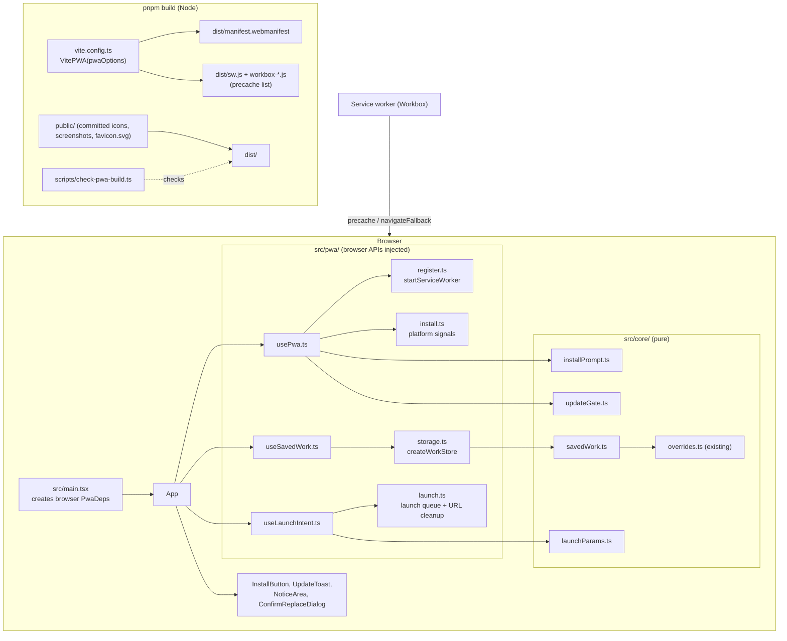
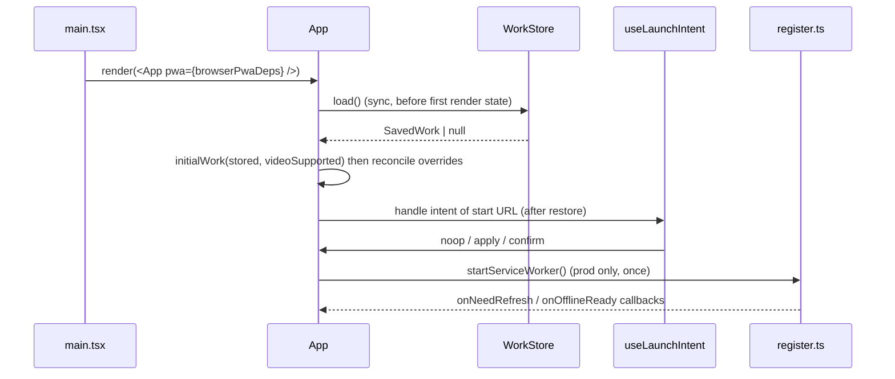

# Design Document: scenebeat-pwa

## Overview

This design makes SceneBeat an installable Progressive Web App that works offline, remembers work on the device, and integrates with the operating system (shortcuts, share target, launch handling). It extends `scenebeat-mvp` and `scenebeat-edit-export`; nothing in those specs changes behaviour except where this document says so (start-up now restores Saved_Work before falling back to the sample transcript).

The design keeps the existing layering:

- **Pure logic in `src/core/`**: `savedWork.ts`, `launchParams.ts`, `installPrompt.ts`, `updateGate.ts`. Deterministic, no DOM, no storage, no timers. These carry the correctness properties (P52 onward).
- **Browser layer in `src/pwa/`**: every browser API (service worker registration, `beforeinstallprompt`, `matchMedia`, `localStorage`, `launchQueue`, `history`, `document.visibilityState`, timers) arrives as an injected dependency, the same pattern `src/video/` uses with `RenderDeps`.
- **UI in `src/components/`**: `InstallButton`, `UpdateToast`, `NoticeArea`, `ConfirmReplaceDialog`, plus a "Saved on this device only" note in `TranscriptInput`.
- **Build**: `vite-plugin-pwa` generates the manifest and a Workbox service worker. Node scripts generate the committed icons and check the finished build.

### Decisions

| Decision | Choice | Reason |
|---|---|---|
| PWA tooling | `vite-plugin-pwa` 2.0.0 (devDependency; peer `vite ^8`), with `workbox-build` and `workbox-window` `^7.4.1` | Generates a content-hashed precache list and the manifest from one typed config; avoids a hand-written service worker. |
| Strategy | `strategies: 'generateSW'`, `registerType: 'prompt'`, `injectRegister: false`, `devOptions: { enabled: false }` | The app needs only precache plus navigation fallback, which `generateSW` covers. `prompt` lets the app decide when to reload (Req 7). Registration stays in our code so it can be injected and skipped in dev (Req 6). |
| Registration API | `registerSW` from `virtual:pwa-register`, wrapped by our `src/pwa/register.ts` and imported only from `src/main.tsx` | Tests never resolve the virtual module; `App` receives a `PwaDeps` object and tests pass fakes (Req 6.5, 17.8). |
| Base path | Vite `base: './'`; manifest `id`, `start_url`, `scope`, icon, screenshot, shortcut, and share-target URLs are all relative (`./…`) | One build works at `/` and at `/scenebeat/` (Req 4). A build-check script rejects root-absolute URLs (Req 17.7). |
| Runtime caching | None | Req 5.5 and 18.4: requests outside the App_Shell go straight to the network and are never cached. |
| Icons | `scripts/generate-pwa-assets.ts` rasterises the play-mark with a small pure-JS PNG encoder (`node:zlib` deflate, CRC-32 table); outputs are committed under `public/` | No image dependency, no network, and `pnpm build` only copies files (Req 2.6). |
| Screenshots | Captured manually from the running app with Chrome DevTools ("Capture screenshot" at a fixed device size) and committed; until then the script writes branded placeholders of the exact sizes, and never overwrites an existing screenshot | Real screenshots need the real UI; placeholders keep the manifest valid from the first commit. |
| Persistence | One versioned `localStorage` key `scenebeat:work:v1`, written 500 ms after the last change, flushed on `visibilitychange: hidden` and `pagehide` | Small, synchronous, survives reloads and updates; matches Req 13. |
| Launch handling | Start URL parsed once after restore; later launches arrive through `window.launchQueue` when available | Req 16; `launch_handler.client_mode: focus-existing` reuses the window. |

## Architecture



### Start-up sequence



## Components and Interfaces

All signatures are TypeScript. Existing types come from `src/core/types.ts` (`SceneOverrides`, `SceneOverride`, `SceneTemplate`, `TEMPLATES`) and `src/core/aspectRatio.ts` (`AspectRatioId`, `ASPECT_RATIOS`).

### `src/core/savedWork.ts`

```ts
export const SAVED_WORK_KEY = 'scenebeat:work:v1';
export const SAVE_LIMIT = 1_000_000; // UTF-16 code units

// Moved from src/components/ExportPanel.tsx so core code can use them;
// ExportPanel.tsx imports and re-exports them, so existing imports keep working.
export type ExportFormat = 'video' | 'subtitles' | 'storyboard-json';
export type SubtitleFormat = 'srt' | 'vtt';

export interface SavedWork {
  transcript: string;
  overrides: SceneOverrides;
  aspectRatio: AspectRatioId;
  exportFormat: ExportFormat;
  subtitleFormat: SubtitleFormat;
}

export type ParseWorkResult = { ok: true; work: SavedWork } | { ok: false };

export function serializeWork(work: SavedWork): string;
export function parseWork(raw: string): ParseWorkResult;          // never throws

export interface WorkDefaults { aspectRatio: AspectRatioId; exportFormat: ExportFormat; subtitleFormat: SubtitleFormat }
export function defaultWorkSettings(videoSupported: boolean): WorkDefaults;

/** Start-up state: restored work or the sample transcript with defaults. */
export function initialWork(
  stored: string | null,
  videoSupported: boolean,
  sampleTranscript: string,
): { work: SavedWork; restored: boolean };
```

### `src/core/launchParams.ts`

```ts
export type LaunchIntent =
  | { kind: 'none' }
  | { kind: 'new-transcript' }
  | { kind: 'load-sample' }
  | { kind: 'share'; transcript: string };

export const LAUNCH_PARAM_NAMES = ['action', 'title', 'text', 'url'] as const;

export function parseLaunchParams(search: string): LaunchIntent;   // never throws
export function buildSharedTranscript(title: string, text: string, url: string): string;

export type LaunchResolution =
  | { kind: 'noop' }
  | { kind: 'apply'; transcript: string; focusInput: boolean }
  | { kind: 'confirm'; transcript: string; focusInput: boolean };

/** Decides whether an intent applies directly or needs the Replace_Confirmation. */
export function resolveLaunch(intent: LaunchIntent, currentTranscript: string, sampleTranscript: string): LaunchResolution;

/** Returns `search` with action/title/text/url removed (other params kept, order kept). */
export function stripLaunchParams(search: string): string;
```

### `src/core/installPrompt.ts`

```ts
export type InstallState = 'hidden' | 'install-available' | 'ios-instructions' | 'installed';

export interface InstallSignals {
  standalone: boolean;
  iosSafari: boolean;
  promptAvailable: boolean;   // a captured beforeinstallprompt that has not been used
  appInstalled: boolean;      // appinstalled fired on this launch
  dismissed: boolean;         // scenebeat:install-dismissed:v1 recorded
}

export type InstallEvent =
  | { type: 'prompt-captured' }
  | { type: 'prompt-closed' }          // dialog closed, accepted or declined
  | { type: 'app-installed' }
  | { type: 'standalone-changed'; standalone: boolean }
  | { type: 'dismissed' };

export function initialInstallSignals(p: { standalone: boolean; iosSafari: boolean; dismissed: boolean }): InstallSignals;
export function installReducer(s: InstallSignals, e: InstallEvent): InstallSignals;
export function installState(s: InstallSignals): InstallState;
```

### `src/core/updateGate.ts`

```ts
export interface UpdateInputs { updateAvailable: boolean; renderInProgress: boolean; editing: boolean; later: boolean }
export interface UpdateView {
  visible: boolean;
  reloadEnabled: boolean;
  note: null | 'Available after the video finishes' | 'Finish editing to reload';
}
export function updateGate(i: UpdateInputs): UpdateView;
```

### `src/pwa/manifest.ts` (pure data, imported by `vite.config.ts` and tests)

```ts
export const APP_DESCRIPTION: string;        // equal to index.html <meta name="description">
export const THEME_COLOR = '#121110';
export const MANIFEST: WebAppManifest;       // typed object; exact fields in "Manifest" below
export function manifestUrls(m: WebAppManifest): string[]; // id, start_url, scope, icon/screenshot src, shortcut url, share_target.action
```

`WebAppManifest` is a local interface covering the fields used (the plugin's `ManifestOptions` type is only imported in `vite.config.ts`, so `src/` does not depend on the plugin's types).

### `src/pwa/register.ts`

```ts
export interface SwCallbacks { onNeedRefresh(): void; onOfflineReady(): void; onRegisterError(e: unknown): void }
export type RegisterSW = (opts: { immediate: true } & SwCallbacks) => (reloadPage?: boolean) => Promise<void>;

export interface ServiceWorkerHandle { applyUpdate(): Promise<void> }  // activate waiting worker, then reload

export function startServiceWorker(deps: {
  isProduction: boolean;           // import.meta.env.PROD in main.tsx
  supported: boolean;              // 'serviceWorker' in navigator
  registerSW: RegisterSW;          // from virtual:pwa-register in main.tsx
}, cb: SwCallbacks): ServiceWorkerHandle | null;   // null = skipped (dev, unsupported); idempotent per deps object
```

`registerSW` from the plugin registers `./sw.js` relative to the document with scope `./`, which resolves to the Deployment_Base because the only document is `index.html` at the base (Req 4.3).

### `src/pwa/install.ts`

```ts
export interface InstallPromptEventLike extends Event { prompt(): Promise<void>; userChoice: Promise<{ outcome: 'accepted' | 'dismissed' }> }
export interface InstallEnv {
  matchMedia(q: string): { matches: boolean; addEventListener(t: 'change', f: () => void): void; removeEventListener(t: 'change', f: () => void): void };
  userAgent: string; platform: string; maxTouchPoints: number;
  navigatorStandalone: boolean | undefined;   // iOS navigator.standalone
  addWindowListener(type: 'beforeinstallprompt' | 'appinstalled', f: (e: Event) => void): () => void;
}
export function isStandalone(env: InstallEnv): boolean;   // display-mode standalone | window-controls-overlay | navigator.standalone
export function isIosSafari(env: InstallEnv): boolean;    // iPhone/iPad/iPod, or MacIntel with touch; excludes CriOS/FxiOS/EdgiOS
```

### `src/pwa/storage.ts`

```ts
export interface StorageLike { getItem(k: string): string | null; setItem(k: string, v: string): void; removeItem(k: string): void }
export interface Timers { setTimeout(f: () => void, ms: number): number; clearTimeout(id: number): void }
export type StoreNotice = 'too-large' | 'unavailable';

export interface WorkStore {
  load(): string | null;              // raw string; parsing happens in initialWork
  schedule(work: SavedWork): void;    // debounced write, 500 ms after the last call
  flush(): void;                      // write a pending value now
  clear(): void;                      // cancel pending write, removeItem(SAVED_WORK_KEY)
  dispose(): void;
}
export function createWorkStore(deps: {
  storage: StorageLike | null; timers: Timers; onNotice(n: StoreNotice): void;
  delayMs?: number; limit?: number;   // defaults 500 and SAVE_LIMIT
}): WorkStore;

export function createMemoryStorage(): StorageLike;   // used by App defaults and tests
export function readFlag(s: StorageLike | null, key: string): boolean;
export function writeFlag(s: StorageLike | null, key: string): void;  // swallows errors
```

### `src/pwa/launch.ts`

```ts
export interface LaunchEnv {
  initialSearch: string;                                              // location.search at start
  replaceSearch(search: string): void;                                // history.replaceState keeping path and hash
  launchQueue?: { setConsumer(f: (p: { targetURL?: string }) => void): void };
}
```

### Hooks

```ts
// src/pwa/usePwa.ts
export function usePwa(deps: PwaDeps, status: { renderInProgress: boolean; editing: boolean; flushWork(): void }): {
  installState: InstallState; install(): void; dismissInstall(): void;
  update: UpdateView; reload(): void; later(): void;
  offlineReady: boolean; dismissOfflineReady(): void;
};

// src/pwa/useSavedWork.ts
export function useSavedWork(store: WorkStore, work: SavedWork, events: { onHidden(f: () => void): () => void }): void;

// src/pwa/useLaunchIntent.ts
export function useLaunchIntent(env: LaunchEnv, opts: {
  ready: boolean; renderInProgress: boolean; currentTranscript: string; sampleTranscript: string;
  onApply(r: { transcript: string; focusInput: boolean }): void;
  onConfirm(r: { transcript: string; focusInput: boolean }): void;
}): void;
```

### `PwaDeps` (`src/pwa/deps.ts`)

```ts
export interface PwaDeps {
  sw: { isProduction: boolean; supported: boolean; registerSW: RegisterSW };
  install: InstallEnv | null;     // null: install UI stays hidden
  storage: StorageLike | null;    // null: localStorage unavailable
  timers: Timers;
  launch: LaunchEnv;
  onHidden(f: () => void): () => void;   // visibilitychange→hidden and pagehide
}
export function defaultPwaDeps(): PwaDeps;   // tests: no SW, no install env, in-memory storage, empty search
```

`src/pwa/browserDeps.ts` builds the real `PwaDeps` (imports `virtual:pwa-register`) and is imported only by `src/main.tsx`.

### UI components

| Component | Props | Behaviour |
|---|---|---|
| `InstallButton` | `state: InstallState`, `onInstall`, `onDismiss` | `install-available`: "Install app" button plus a small dismiss (×) button labelled "Dismiss install". `ios-instructions`: text "Install: tap Share, then Add to Home Screen" with a dismiss button. Otherwise renders nothing. Sits in the header. |
| `UpdateToast` | `view: UpdateView`, `onReload`, `onLater` | Renders when `view.visible`: "New version available", "Reload" (`disabled` when `!reloadEnabled`), "Later", and `view.note` when set. Not modal; no focus trap. |
| `NoticeArea` | `children` | `<div role="status" aria-live="polite">` fixed at the bottom; holds `UpdateToast`, the Offline_Ready_Notice (with a "Dismiss" button), and storage notices. |
| `ConfirmReplaceDialog` | `open`, `onReplace`, `onKeep` | Native `<dialog>` opened with `showModal()` when available (fallback: `role="dialog" aria-modal="true"`), title "Replace your current transcript?", buttons "Replace" and "Keep current"; Escape counts as "Keep current". |
| `TranscriptInput` (changed) | new optional `savedNote?: string` | Shows "Saved on this device only" under the textarea. |
| `StoryboardList` (changed) | new optional `onEditingChange?(editing: boolean)` | `StoryboardList` already owns `editingIndex` (which row's `SceneEditor` text field is open); it reports `editingIndex !== null` through this callback, feeding the Editing_Session flag. `SceneEditor` itself is unchanged. |

## Manifest

Generated by `vite-plugin-pwa` from `MANIFEST` (`manifestFilename: 'manifest.webmanifest'`, `includeManifestIcons: true`). The plugin injects `<link rel="manifest" href="./manifest.webmanifest">` into `index.html` with the relative base.

```json
{
  "name": "SceneBeat",
  "short_name": "SceneBeat",
  "description": "<APP_DESCRIPTION, identical to index.html meta description>",
  "id": "./",
  "start_url": "./",
  "scope": "./",
  "display": "standalone",
  "display_override": ["window-controls-overlay", "standalone"],
  "theme_color": "#121110",
  "background_color": "#121110",
  "orientation": "any",
  "lang": "en",
  "dir": "ltr",
  "categories": ["productivity", "utilities"],
  "icons": [
    { "src": "./icons/icon-192.png", "sizes": "192x192", "type": "image/png", "purpose": "any" },
    { "src": "./icons/icon-512.png", "sizes": "512x512", "type": "image/png", "purpose": "any" },
    { "src": "./icons/icon-maskable-512.png", "sizes": "512x512", "type": "image/png", "purpose": "maskable" }
  ],
  "screenshots": [
    { "src": "./screenshots/wide.png", "sizes": "1280x720", "type": "image/png", "form_factor": "wide", "label": "SceneBeat with the Player and the storyboard list" },
    { "src": "./screenshots/narrow.png", "sizes": "750x1334", "type": "image/png", "form_factor": "narrow", "label": "SceneBeat on a phone" }
  ],
  "shortcuts": [
    { "name": "New transcript", "url": "./?action=new", "icons": [{ "src": "./icons/icon-192.png", "sizes": "192x192", "type": "image/png" }] },
    { "name": "Load sample", "url": "./?action=sample", "icons": [{ "src": "./icons/icon-192.png", "sizes": "192x192", "type": "image/png" }] }
  ],
  "share_target": { "action": "./", "method": "GET", "params": { "title": "title", "text": "text", "url": "url" } },
  "launch_handler": { "client_mode": "focus-existing" }
}
```

Relative URL resolution: manifest URLs resolve against the manifest URL (`<base>manifest.webmanifest`), so `./` becomes `<base>`. `id` resolves against `start_url`, which is also `<base>`. No `file_handlers` or `protocol_handlers` (Req 18.5).

### Files under `public/` (copied verbatim by Vite)

| Path | Size | Content |
|---|---|---|
| `public/favicon.svg` | vector | `#ff8a3d` rounded square, `#1a0f06` play triangle (same geometry as the current inline favicon in `index.html`: 32×32 viewBox, `rx=9`, triangle `M12 9.5v13l10-6.5z`), which replaces that data-URL favicon |
| `public/icons/icon-192.png`, `icon-512.png` | 192, 512 | Mark at full size on a transparent background |
| `public/icons/icon-maskable-512.png` | 512 | Full-bleed `#121110`; mark scaled to a square of side 0.52 × width centred, so its corners (diagonal 0.735 × width) stay inside the 0.8 × width safe circle (Req 2.3) |
| `public/icons/apple-touch-icon-180.png` | 180 | Full-bleed `#ff8a3d` with the play triangle (iOS fills transparency with black and applies its own corner mask) |
| `public/screenshots/wide.png` | 1280×720 | Manual capture (placeholder until then) |
| `public/screenshots/narrow.png` | 750×1334 | Manual capture (placeholder until then) |

### `vite.config.ts` plugin options

```ts
VitePWA({
  strategies: 'generateSW',
  registerType: 'prompt',
  injectRegister: false,
  manifestFilename: 'manifest.webmanifest',
  manifest: MANIFEST,
  includeManifestIcons: true,
  devOptions: { enabled: false },
  workbox: {
    globPatterns: ['**/*.{js,css,html,svg,png,webp,woff2}'],
    navigateFallback: 'index.html',
    cleanupOutdatedCaches: true,
    runtimeCaching: [],
    clientsClaim: false,
    skipWaiting: false,
  },
})
```

The plugin adds `manifest.webmanifest` to the precache list itself, so the manifest is part of the App_Shell even though `webmanifest` is not in `globPatterns`. Workbox's default `maximumFileSizeToCacheInBytes` (2 MiB) is enough; the screenshot capture instructions ask for PNGs under 1 MiB, and the build check fails if any shell file was skipped.

## Data Models

### Stored Saved_Work (`scenebeat:work:v1`)

```json
{
  "version": 1,
  "transcript": "First line. 2025年 we grew 3倍.",
  "overrides": {
    "<overrideKey(sourceText, rank)>": { "sourceText": "First line.", "rank": 0, "editedText": "First line!", "manualTemplate": "quote" }
  },
  "aspectRatio": "16:9",
  "exportFormat": "video",
  "subtitleFormat": "srt"
}
```

- Key order is fixed: top level `version, transcript, overrides, aspectRatio, exportFormat, subtitleFormat`; each override `sourceText, rank, editedText?, manualTemplate?`.
- `serializeWork` writes override entries sorted by key (code-unit order) so the output does not depend on object insertion order, and string round trips are stable. `JSON.stringify` without indentation.
- Defaults: `aspectRatio` `DEFAULT_ASPECT_RATIO` (`16:9`), `exportFormat` = `defaultWorkSettings(videoSupported).exportFormat`, which is the rule `App.tsx` uses today (`video` when supported, otherwise `subtitles`), `subtitleFormat` `srt`.
- `overrideKey(sourceText, rank)` is `JSON.stringify([rank, sourceText])` (for example `[0,"First line."]`), so keys are never integer-like and JavaScript does not reorder them.
- The existing `SceneOverride` invariant also says `editedText` differs from `sourceText`. The parser checks only the rules of Requirement 12.7; an entry whose `editedText` equals its `sourceText` is accepted and then neutralised by the existing `reconcileOverrides`/`applyOverride` path. Generators for valid Saved_Work produce entries that satisfy the full existing invariant.

### Other `localStorage` keys

| Key | Value | Written when |
|---|---|---|
| `scenebeat:offline-ready-shown:v1` | `"1"` | The Offline_Ready_Notice is first shown |
| `scenebeat:install-dismissed:v1` | `"1"` | The user dismisses the Install_UI |

### In-memory state added to `App`

| State | Type | Source |
|---|---|---|
| `installSignals` | `InstallSignals` | `installReducer` (inside `usePwa`) |
| `updateAvailable`, `updateLater` | `boolean` | SW callbacks, "Later" button; reset only by a new launch |
| `offlineReady` | `boolean` | `onOfflineReady` and flag check; auto-hides after 8 s |
| `storeNotice` | `StoreNotice \| null` | `WorkStore.onNotice`; `unavailable` shown once per launch |
| `editing` | `boolean` | `SceneEditor.onEditingChange` |
| `pendingReplace` | `{ transcript: string; focusInput: boolean } \| null` | `useLaunchIntent.onConfirm` |

## Algorithms

### `serializeWork`

Build a fresh object literal in the fixed key order; for overrides iterate `Object.keys(work.overrides).sort()` and copy only `sourceText`, `rank`, then `editedText` and `manualTemplate` when defined. Return `JSON.stringify(obj)`.

### `parseWork(raw)`

1. `try { v = JSON.parse(raw) } catch { return { ok: false } }`.
2. Reject unless `v` is a non-null, non-array object with `v.version === 1` and `typeof v.transcript === 'string'`.
3. Overrides: if `v.overrides` is not a plain object, use `{}`. For each own key `k` with value `e`: keep it only if `e` is an object, `typeof e.sourceText === 'string'`, `Number.isInteger(e.rank) && e.rank >= 0`, `k === overrideKey(e.sourceText, e.rank)`, `editedText` absent or a non-empty string, `manualTemplate` absent or in `TEMPLATES`, and at least one of the two present. The kept value is rebuilt with only the known fields.
4. Settings: each of `aspectRatio`, `exportFormat`, `subtitleFormat` is kept when in its allowed set, else replaced by the static default (`16:9`, `video`, `srt`). `initialWork` later swaps `video` for the browser default when video is unsupported (Req 13.5).
5. Unknown top-level keys are ignored. All property access goes through `Object.prototype.hasOwnProperty.call` and `typeof` checks, so no input can throw (Req 12.9). The result is built from validated fields only; an override key `__proto__` can never equal an `overrideKey` value (those start with `[`), so it is dropped by the key check before any assignment.

### `initialWork(stored, videoSupported, sample)`

- `stored === null` or `parseWork(stored).ok === false` → `{ work: { transcript: sample, overrides: {}, ...defaultWorkSettings(videoSupported) }, restored: false }`.
- Otherwise the parsed work, with `exportFormat` replaced by `defaultWorkSettings(videoSupported).exportFormat` when it is `video` and `!videoSupported`, and `restored: true`.

`App` then runs the existing reconcile step from `src/core/overrides.ts` against the Automatic_Scenes of the restored transcript, exactly as after a transcript edit (Req 13.4).

### `createWorkStore` (debounce, limit, failures)

- `schedule(work)`: store `pending = work`, clear the old timer, start a new `delayMs` timer that calls `flush()`.
- `flush()`: if no `pending`, return. `s = serializeWork(pending)`; `pending = null`. If `s.length > limit` → `onNotice('too-large')`, leave storage untouched. If `storage === null` → `onNotice('unavailable')`. Else `try { storage.setItem(KEY, s) } catch { onNotice('unavailable') }`.
- `clear()`: cancel timer, `pending = null`, `try { storage?.removeItem(KEY) } catch {}`.
- `load()`: `try { return storage?.getItem(KEY) ?? null } catch { onNotice('unavailable'); return null }`.
- The hook shows `unavailable` at most once per launch; `too-large` stays until the next successful write clears it.
- `useSavedWork` calls `schedule` from an effect whose dependencies are the five Saved_Work fields, skipping the first run after restore, and registers `flush` with `onHidden` (Req 13.2). "Clear" calls `store.clear()` before updating the transcript; the resulting change schedules the write of the cleared state (Req 13.9).

### `parseLaunchParams(search)`

```
p = new URLSearchParams(search)            // never throws for a string
if any of p.has('title'|'text'|'url'):
    t = buildSharedTranscript(p.get('title') ?? '', p.get('text') ?? '', p.get('url') ?? '')
    return t === '' ? none : share(t)      // share wins over action (15.2, 15.4)
switch p.get('action'): 'new' → new-transcript; 'sample' → load-sample; else none
```

When a parameter repeats, the first value is used.

### `buildSharedTranscript(title, text, url)`

```
r = text.trim()
T = title.trim(); if T !== '' and !r.includes(T): r = r === '' ? T : T + '\n' + r
U = url.trim();   if U !== '' and !r.includes(U): r = r === '' ? U : r + '\n' + U
return r
```

The line break is only added between two non-empty parts, so the result never starts or ends with a stray newline. Non-empty trimmed `text` is always a substring of the result (Req 15.5).

### `resolveLaunch(intent, current, sample)`

| Intent | Target transcript | `focusInput` |
|---|---|---|
| `none` | → `noop` | |
| `new-transcript` | `''` | `true` |
| `load-sample` | `sample` | `false` |
| `share` | `intent.transcript` | `false` |

Result: `confirm` when `current.trim() !== ''` and `current !== target`; otherwise `apply`. `apply` for `new-transcript` runs the same handler as the "Clear" button, then focuses the textarea; `load-sample` runs the "Load sample" handler; `share` sets the transcript and reconciles overrides.

### `useLaunchIntent`

1. Wait until `ready` (Saved_Work restored, Req 16.2). Parse `env.initialSearch` once.
2. If a Render_Job is in progress, keep the intent as `deferred` (latest wins) and process it when `renderInProgress` turns false (Req 16.4).
3. Process: `resolveLaunch` → `onApply` or `onConfirm`; then, when the intent is not `none`, `env.replaceSearch(stripLaunchParams(search))` (Req 16.5).
4. If `env.launchQueue` exists, `setConsumer` once. Chromium also delivers the initial navigation to the consumer; a delivery whose `targetURL` search equals `initialSearch` and arrives before any other delivery is ignored, so the start URL is handled once. Each later `targetURL` goes through steps 2 and 3 without reloading (Req 16.3).

### `installReducer` and `installState`

Reducer: `prompt-captured` → `promptAvailable = true`; `prompt-closed` → `promptAvailable = false`; `app-installed` → `appInstalled = true, promptAvailable = false`; `standalone-changed` → set `standalone`; `dismissed` → `dismissed = true`.

```
installState(s):
  if s.standalone or s.appInstalled → 'installed'
  if s.dismissed                    → 'hidden'
  if s.promptAvailable              → 'install-available'
  if s.iosSafari                    → 'ios-instructions'
  return 'hidden'
```

The browser layer calls `preventDefault()` on `beforeinstallprompt`, keeps the event in a ref, and on "Install app" calls `prompt()`, awaits `userChoice`, then dispatches `prompt-closed` and drops the ref (Req 9.2, 9.3). Dismissal writes `scenebeat:install-dismissed:v1` and dispatches `dismissed`.

### `updateGate`

```
visible       = updateAvailable && !later
reloadEnabled = visible && !renderInProgress && !editing
note          = !visible ? null
              : renderInProgress ? 'Available after the video finishes'
              : editing ? 'Finish editing to reload'
              : null
```

"Reload" calls `flushWork()` (the Work_Store `flush`), then `handle.applyUpdate()`, which is the plugin's `updateSW(true)`: it posts `SKIP_WAITING` to the waiting worker and reloads when it takes control (Req 7.6).

### Offline ready

`onOfflineReady` fires once after the first install fills the Precache. `usePwa` shows the notice only when `readFlag(storage, 'scenebeat:offline-ready-shown:v1')` is false, then writes the flag, and starts an 8000 ms timer through `deps.timers` that hides it (Req 8).

### PNG asset generation (`scripts/generate-pwa-assets.ts`, `scripts/png.ts`)

- `encodePng(width, height, rgba: Uint8Array): Buffer`: PNG signature, `IHDR` (8-bit RGBA, colour type 6), one `IDAT` with `zlib.deflateSync` of rows each prefixed by filter byte 0, `IEND`; CRC-32 from a precomputed table.
- `rasterise(size, scene)`: for each pixel, 4×4 supersampling against signed shapes (rounded rectangle with corner radius 9/32 of the side, triangle scaled from the favicon path; triangle by edge functions), alpha-composited over the background.
- Writes `public/favicon.svg`, the four icons, and the two screenshot placeholders (`#121110` background, centred mark, "SceneBeat" is not drawn as text to avoid a font rasteriser). Existing screenshot files are never overwritten; icons are always regenerated (deterministic output).
- Run with `pnpm generate:pwa-assets`. Not part of `pnpm build`.

### Build check (`scripts/check-pwa-build.ts`)

`pnpm check:pwa [dir=dist]` exits 0 or 1. Exported pure `checkBuild(files: Map<string, string | Uint8Array>): string[]` returns problems:

1. Required files: `index.html`, `manifest.webmanifest`, `sw.js`, at least one `workbox-*.js`.
2. Precache list: every `.html`, `.js`, `.css` file (except `sw.js` and `workbox-*.js`) and every file under `icons/` appears as a quoted URL in `sw.js`.
3. Root-absolute URLs: none in `index.html` `src`/`href` attributes, none in `url(/…)` inside CSS, none among `manifestUrls` of the built manifest, and the precache URLs in `sw.js` do not start with `/`.

## Styling

Changes in `src/styles/app.css`; no new stylesheet.

```css
html { -webkit-text-size-adjust: 100%; }
.sb-app {
  min-height: 100vh;
  min-height: 100dvh;
  padding-top: max(<existing>, env(safe-area-inset-top));
  padding-right: max(<existing>, env(safe-area-inset-right));
  padding-bottom: max(<existing>, env(safe-area-inset-bottom));
  padding-left: max(<existing>, env(safe-area-inset-left));
}
button, a, [role="button"], input[type="radio"] + label, select { -webkit-tap-highlight-color: transparent; }
button, .chip, .segmented, .segmented * { user-select: none; -webkit-user-select: none; }
textarea, input[type="text"], .scene-text { user-select: text; -webkit-user-select: text; }

@media (display-mode: standalone), (display-mode: window-controls-overlay) {
  html, body { overscroll-behavior: none; }
}
html.sb-standalone, html.sb-standalone body { overscroll-behavior: none; }  /* iOS navigator.standalone */

@media (display-mode: window-controls-overlay) {
  .sb-header {
    position: fixed;
    left: env(titlebar-area-x, 0); top: env(titlebar-area-y, 0);
    width: env(titlebar-area-width, 100%); height: env(titlebar-area-height, 40px);
    app-region: drag; -webkit-app-region: drag;
  }
  .sb-header button, .sb-header a, .sb-header [role="button"] { app-region: no-drag; -webkit-app-region: no-drag; }
  .sb-main { padding-top: env(titlebar-area-height, 40px); }
}
```

- Existing `:focus-visible` outlines stay untouched (Req 10.5).
- The tab case keeps browser default overscroll because no rule applies outside the display-mode queries (Req 10.4).
- `.sb-standalone` is set on `<html>` by `browserDeps.ts` when `navigator.standalone === true`.
- In Window_Controls_Overlay the `.sb-header` hides `.sb-header__title` and `.sb-header__tagline` (they move into the first card as plain text) and shows only `.sb-brand` and the Install_UI (hidden there anyway because the state is `installed`), compacted to the title-bar height. The titlebar area excludes the window controls, so header content never sits under them; the main content starts below the title bar (Req 11.4). Outside WCO the header keeps its current layout (Req 11.5).
- `index.html` changes: viewport `width=device-width, initial-scale=1, viewport-fit=cover`; `<link rel="icon" type="image/svg+xml" href="./favicon.svg">`; `<link rel="apple-touch-icon" sizes="180x180" href="./icons/apple-touch-icon-180.png">`; the four `*-capable`/status-bar/title meta tags; `<meta name="theme-color" content="#121110">` (Req 3).

## App wiring

`App` gains one optional prop `pwa?: PwaDeps` (default `defaultPwaDeps()`), so existing component tests render unchanged with in-memory storage and no service worker.

1. **First render**: `store = createWorkStore(...)` in a ref; `initialWork(store.load(), videoSupport.supported, SAMPLE_TRANSCRIPT)` replaces the current initial values of `text`, `overridesState`, `ratio`, `exportFormat`, and `subtitleFormat` (lazy `useState` initialisers). `App` already reconciles `overridesState` against `auto.scenes` during render whenever the Automatic_Scenes change; restored overrides go through that same path, which satisfies Req 13.4 without new code. `ExportPanel` is already controlled (`format`, `onFormatChange`, `subtitleFormat`, `onSubtitleFormatChange`), so it needs no prop changes.
2. **Saving**: `useSavedWork(store, work, pwa.onHidden)`.
3. **Launch**: `useLaunchIntent(pwa.launch, { ready: true, renderInProgress, currentTranscript, sampleTranscript, onApply, onConfirm })`. `onConfirm` sets `pendingReplace`; `ConfirmReplaceDialog` "Replace" applies it, "Keep current" clears it (Req 15.9, 15.10).
4. **PWA**: `usePwa(pwa, { renderInProgress, editing, flushWork: store.flush })` → `InstallButton` in the header, `UpdateToast` and offline/storage notices in `NoticeArea`.
5. **Render state**: `renderInProgress` is the existing `locked` value (`renderStatus.phase === 'rendering'`).
6. **Editing state**: `editing` comes from `StoryboardList.onEditingChange`.
7. `src/main.tsx`: `createRoot(...).render(<App pwa={createBrowserPwaDeps()} />)`.

## Error Handling

| Situation | Behaviour | Requirement |
|---|---|---|
| Service workers unsupported, dev server, or `onRegisterError` | No registration or registration result ignored; no Update_Prompt or Offline_Ready_Notice; app works online | 6.3, 6.4 |
| Stored Saved_Work is corrupt, wrong version, or wrong type | `parseWork` returns `{ ok: false }`; sample transcript and defaults; next write replaces it | 12.5, 12.6, 13.6 |
| Individual override entries invalid | Dropped; valid entries kept | 12.7 |
| Setting value outside its set | Field default, other fields kept | 12.8 |
| Restored `video` format without video support | Export_Panel default for this browser | 13.5 |
| Serialized work longer than 1,000,000 code units | Previous stored string kept; notice "This transcript is too large to save on this device" | 13.7 |
| `localStorage` missing, `getItem`/`setItem` throws (quota, privacy mode) | App keeps working; notice "Your work can't be saved in this browser" once per launch | 13.8 |
| Flag keys unreadable/unwritable | Treated as "not set"; write errors swallowed (notice may show again next launch) | 8.3, 9.8 |
| `beforeinstallprompt.prompt()` rejects | Treated as dialog closed: button hidden | 9.3 |
| Launch params malformed (bad percent-encoding, odd values) | `URLSearchParams` decodes leniently; unknown `action` → `none` | 15.5 |
| Launch intent during a render | Deferred until the render completes, is cancelled, or fails | 16.4 |
| `history.replaceState` throws | Ignored; intent stays handled for this page | 16.5 |
| Precache install fails (e.g. offline during first visit) | Workbox discards the install; next online visit retries; app still works online | 5.1 |

## Correctness Properties

*A property is a characteristic or behavior that should hold true across all valid executions of a system-essentially, a formal statement about what the system should do. Properties serve as the bridge between human-readable specifications and machine-verifiable correctness guarantees.*

### Property 52: Saved work round trip

*For any* valid Saved_Work `w` (overrides keyed by `overrideKey`, each with a non-empty `editedText` or a template or both), `parseWork(serializeWork(w))` returns `{ ok: true, work }` with `work` deep-equal to `w`, and `serializeWork(work) === serializeWork(w)`; the serialized object's keys appear in the order of Requirement 12.1 and each override's keys in the order of Requirement 12.2.

**Validates: Requirements 12.1, 12.2, 12.3, 12.4**

### Property 53: Work parser is total and its output is valid

*For any* string, including arbitrary text, arbitrary JSON values, and mutated serializations of valid Saved_Work, `parseWork` returns without throwing; it returns `{ ok: false }` whenever the value is not a JSON object, `version !== 1`, or `transcript` is not a string; and whenever it returns `{ ok: true, work }`, every field of `work` satisfies the constraints of Requirements 12.1 and 12.2.

**Validates: Requirements 12.5, 12.6, 12.9, 12.10**

### Property 54: Invalid override entries are dropped individually

*For any* valid Saved_Work and any set of invalid override entries (each breaking exactly one rule of Requirement 12.7) mixed into its `overrides`, parsing the result yields exactly the original valid overrides.

**Validates: Requirements 12.7**

### Property 55: Out-of-range settings fall back per field

*For any* valid Saved_Work and any subset of `aspectRatio`, `exportFormat`, `subtitleFormat` replaced by arbitrary values outside their allowed sets, the parser returns `ok: true`, each replaced field equals its default, and every other field equals the original.

**Validates: Requirements 12.8**

### Property 56: Start-up state from storage

*For any* stored value (null, an arbitrary string, or a serialized valid Saved_Work) and any `videoSupported`, `initialWork` returns the parsed Saved_Work with `restored: true` when `parseWork` accepts the value, except that `exportFormat` `video` becomes the browser default when `videoSupported` is false; and returns the sample transcript, no overrides, and default settings with `restored: false` otherwise.

**Validates: Requirements 13.3, 13.5, 13.6**

### Property 57: Debounced saving writes the latest work

*For any* sequence of Saved_Work changes separated by random delays, followed by either 500 ms of quiet or a hidden/pagehide event, with an in-memory storage and fake timers, the stored string equals `serializeWork` of the last change, and no write happens while changes keep arriving less than 500 ms apart.

**Validates: Requirements 13.1, 13.2**

### Property 58: Oversized or failing writes never corrupt stored work

*For any* previously stored string and any Saved_Work, flushing with a storage that throws, or with a serialization longer than the Save_Limit, leaves the stored string unchanged and reports exactly the notice `unavailable` or `too-large` respectively, without throwing.

**Validates: Requirements 13.7, 13.8**

### Property 59: Shared transcript composition

*For any* `title`, `text`, and `url` strings, `buildSharedTranscript` equals the reference composition of Requirement 15.3 (trimmed text, then title prepended and url appended when non-empty and not already contained, joined by a line break), contains every non-empty trimmed `text` unchanged, and is empty exactly when all three trimmed values are empty.

**Validates: Requirements 15.3, 15.4, 15.5**

### Property 60: Launch parser totality and precedence

*For any* query string built from arbitrary parameter names and values (including `action`, `title`, `text`, `url`, repeats, and unicode), `parseLaunchParams` returns exactly one Launch_Intent without throwing; the result is `share` or `none` (by Property 59's emptiness rule) whenever `title`, `text`, or `url` is present, regardless of `action`; otherwise it is `new-transcript` for `action=new`, `load-sample` for `action=sample`, and `none` for every other query, including queries with none of the four parameters.

**Validates: Requirements 14.2, 14.3, 15.2, 15.6**

### Property 61: Replace confirmation decision

*For any* Launch_Intent, current transcript, and sample transcript, `resolveLaunch` returns `noop` for `none`, and otherwise targets the intent's transcript (`''`, the sample, or the Shared_Transcript) and returns `confirm` exactly when the current transcript is non-empty after trimming and differs from the target, and `apply` otherwise.

**Validates: Requirements 14.4, 14.5, 14.6, 15.7, 15.8**

### Property 62: Install state invariant

*For any* initial platform signals and any sequence of Install events, after every step `installState` returns exactly one of the four states; it is `installed` whenever `standalone` is true or `app-installed` has occurred; it is `hidden` whenever a dismissal has occurred and the state is not `installed`; it is `install-available` only while a captured prompt has not been closed; and it is `ios-instructions` only when `iosSafari` is true and no captured prompt is pending.

**Validates: Requirements 9.1, 9.3, 9.4, 9.5, 9.6, 9.7, 9.8, 9.9**

### Property 63: Update gate model

*For any* combination of `updateAvailable`, `renderInProgress`, `editing`, and `later`, `updateGate` reports `visible` exactly when `updateAvailable && !later`, `reloadEnabled` exactly when visible and neither a render nor an editing session is active, and the note "Available after the video finishes" when visible with a render in progress, "Finish editing to reload" when visible with editing and no render, and no note otherwise.

**Validates: Requirements 7.4, 7.5, 7.7, 7.8**

### Property 64: Manifest URLs stay under the Deployment_Base

*For any* Deployment_Base (`/`, `/scenebeat/`, and generated paths of one to four URL-safe segments ending in `/`), resolving every URL in `manifestUrls(MANIFEST)` against `https://example.test<base>manifest.webmanifest` (and `id` against the resolved `start_url`) yields a URL whose path starts with that base; and every such URL is relative (does not start with `/` or a scheme).

**Validates: Requirements 4.2, 4.4, 17.4**

### Property 65: Launch parameter stripping

*For any* query string, `stripLaunchParams` returns a query with no `action`, `title`, `text`, or `url` parameter, keeps every other parameter in its original order, and parsing the stripped query yields `none`.

**Validates: Requirements 16.5**

## Testing Strategy

PBT applies to the pure modules in `src/core/` (`savedWork`, `launchParams`, `installPrompt`, `updateGate`) and to the Work_Store and manifest URL helper, which take injected storage and timers. It does not apply to the service worker runtime, browser install dialogs, CSS display modes, or manifest field presence; those use example tests, a build check, and manual Chrome checks.

### Property tests

- fast-check, `{ numRuns: 100 }` minimum, one property per file, files `tests/properties/p52-saved-work-round-trip.property.test.ts` through `p65-launch-param-strip.property.test.ts`.
- Each file has the comment `Feature: scenebeat-pwa, Property N: <text>` and `**Validates: Requirements X.Y**`.
- New generators in `tests/properties/arbitraries.ts`: `savedWorkArb` (reuses the existing override and transcript generators), `invalidOverrideEntryArb` (one broken rule per entry, tagged), `outOfSetValueArb`, `launchQueryArb` (mix of known and random param names, unicode, `+`, `%` sequences, repeats), `installEventsArb`, `deploymentBaseArb`, `changeScheduleArb` (work values plus delays 0 to 1500 ms).
- Property 57 and 58 use `createMemoryStorage()`, a throwing storage, and a hand-rolled fake `Timers` (no `vi.useFakeTimers` needed, since timers are injected).

### Unit and component tests (`tests/*.test.ts(x)`)

| File | Covers |
|---|---|
| `tests/manifest.test.ts` | Every field of Req 1, 14.1, 15.1, 16.1 in `MANIFEST`; `APP_DESCRIPTION` equals the meta description parsed from `index.html`; no `file_handlers`/`protocol_handlers` (17.1, 18.5) |
| `tests/pwaAssets.test.ts` | Each icon and screenshot file exists under `public/`; PNG signature and IHDR width/height match the declared `sizes`; maskable icon corner pixels are `#121110` and pixels outside the 80% circle are background (2.3, 2.5, 17.2) |
| `tests/indexHtml.test.ts` | Link and meta tags of Req 3, all relative (17.3) |
| `tests/register.test.ts` | `startServiceWorker` calls the fake `registerSW` once in production, never when `isProduction` or `supported` is false; register error leaves app usable (6.2 to 6.4, 17.5) |
| `tests/checkPwaBuild.test.ts` | `checkBuild` on in-memory file maps: passing build, missing `sw.js`, unprecached bundle, root-absolute `src` (17.7) |
| `tests/png.test.ts` | `encodePng` output decodes with `zlib.inflateSync` back to the input rows |
| `tests/App.pwa.test.tsx` | With fake `PwaDeps`: restore from storage instead of sample; Clear removes the key; "Saved on this device only" shown; storage notices; update toast appears, Reload disabled during render and while editing, Later hides, Reload flushes then calls `applyUpdate`; offline-ready shown once and hidden after 8 s; install button flow with a fake `beforeinstallprompt`; iOS instructions and dismissal flag; `?action=new` focuses the textarea; share with non-empty transcript opens the dialog, Replace and Keep current; intent deferred during a render; `replaceSearch` called after handling; duplicate initial `launchQueue` delivery ignored |
| Existing tests | Keep passing unchanged; `tests/setup.ts` adds `afterEach(() => localStorage.clear())` as a guard (17.8) |

### Build verification

`pnpm build && pnpm check:pwa` locally and in any CI (17.6, 17.7).

### Manual Chrome checks (documented in README)

1. `pnpm build && pnpm preview`, open DevTools **Application → Manifest**: no errors or warnings; icons, screenshots, shortcuts, share target, and WCO listed; installability section reports no issues.
2. **Application → Service workers**: `sw.js` activated with scope equal to the page base. **Cache storage**: the `workbox-precache-v2-…` cache lists `index.html`, all bundles, the manifest, and icons.
3. **Network → Offline**, reload: the app loads; paste a transcript, edit a scene, export SRT, JSON, and a video.
4. Install from the address-bar install icon and from the in-app "Install app" button; the installed window opens without browser UI. Right-click the dock or taskbar icon: "New transcript" and "Load sample" work, with the confirmation when a transcript exists.
5. In the installed window, toggle the title bar (WCO chevron): header moves into the title bar, drag works on empty areas, buttons click.
6. Update: change a visible string, rebuild, keep the preview tab open, reload once: "New version available" appears; start a video render and confirm Reload is disabled with the note; open a scene editor and confirm the editing note; "Reload" loads the new version with the transcript intact.
7. Persistence: edit, close the window, reopen: transcript, edits, aspect ratio, and export choice are restored.
8. Share target: open `./?text=Hello%20world.&title=Note` directly (Share sheets deliver this only on Android and ChromeOS).
9. Sub-path: `pnpm exec vite preview --base /scenebeat/` and repeat steps 1 to 3 at `http://localhost:4173/scenebeat/`.
10. iOS Safari (device or simulator): instructions shown in the tab; after Add to Home Screen the app opens standalone with content clear of the notch and home indicator, and no overscroll bounce.

## Repository and Documentation Changes

| Path | Change |
|---|---|
| `package.json` | devDependencies `vite-plugin-pwa@2.0.0`, `workbox-window@^7.4.1` (bundled by the register module; `workbox-build` comes with the plugin); scripts `generate:pwa-assets` (`tsx scripts/generate-pwa-assets.ts`) and `check:pwa` (`tsx scripts/check-pwa-build.ts dist`). No runtime `dependencies` added (18.8) |
| `vite.config.ts` | `base: './'`, `VitePWA(...)` options above. Vitest shares this config; the plugin is harmless in tests because no test imports `virtual:pwa-register` |
| `src/vite-env.d.ts` | `/// <reference types="vite-plugin-pwa/client" />` |
| `index.html` | Viewport, icons, meta tags of Req 3; description unchanged and mirrored by `APP_DESCRIPTION` |
| `public/` | New: `favicon.svg`, `icons/*`, `screenshots/*` (committed) |
| `scripts/` | New: `png.ts`, `generate-pwa-assets.ts`, `check-pwa-build.ts` |
| `src/core/` | New: `savedWork.ts`, `launchParams.ts`, `installPrompt.ts`, `updateGate.ts` |
| `src/pwa/` | New: `manifest.ts`, `deps.ts`, `register.ts`, `install.ts`, `storage.ts`, `launch.ts`, `usePwa.ts`, `useSavedWork.ts`, `useLaunchIntent.ts`, `browserDeps.ts` |
| `src/components/` | New: `InstallButton.tsx`, `UpdateToast.tsx`, `NoticeArea.tsx`, `ConfirmReplaceDialog.tsx`; changed: `App.tsx`, `TranscriptInput.tsx` (saved note), `StoryboardList.tsx` (`onEditingChange`), `ExportPanel.tsx` (imports `ExportFormat`/`SubtitleFormat` from `src/core/savedWork.ts` and re-exports them) |
| `src/main.tsx` | Passes `createBrowserPwaDeps()` to `App` |
| `src/styles/app.css` | Styling section above |
| `tests/` | New tests listed above; `tests/setup.ts` clears `localStorage` after each test |
| `README.md` | Install and offline use, saved-work note, deploying under a sub-path, `pnpm generate:pwa-assets`, how to capture screenshots, `pnpm check:pwa`, manual Chrome checklist |
| `.kiro/steering/product.md` | Add PWA capabilities (install, offline, saved work, shortcuts, share target) and scope exclusions of Req 18 |
| `.kiro/steering/tech.md` | Add `vite-plugin-pwa`/Workbox, `base: './'`, new scripts, `src/pwa/` injection rule, property range P52 to P65 for `scenebeat-pwa`; replace "No `fetch` …" with "no network access except the service worker fetching App_Shell files" |
| `.kiro/steering/structure.md` | Add `public/`, `src/pwa/`, new core modules, scripts, and the spec folder `scenebeat-pwa/` (Properties 52 to 65) |
